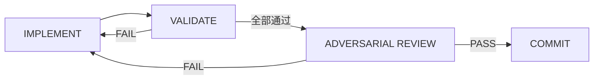
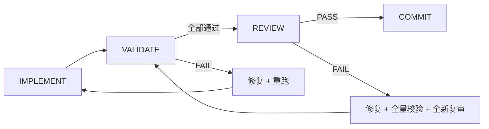

# 编排执行闭环（Orchestrated Execution）

**核心原则**：不信任任何口头结论。逐项验证，逐项留证据，用对抗性审查找违约。

本 skill 定义一个由 Codex 原生子代理驱动的四阶段执行循环：实现、校验、对抗性审查、提交。它把"先实现再审一遍"的线性流程替换为严格闭环：子代理只负责实现，编排者独立执行校验，全新评审子代理基于规格和 DoD 做二值判定。

调用本 skill 即视为用户已授权派子代理，并按本 skill 的模型路由执行。

## 何时使用

满足以下任一条件时使用本 skill：

- 复杂任务被分解为多个工作单元。
- 已有书面规格，并包含可逐项验证的 Definition of Done 条目。
- 多智能体协作中，子代理产出的工作需要独立验证与对抗审查。
- 高风险修改或关键路径改动，自报"已完成"不足以下结论。

不适用场景：

- 单文件小修复、机械复制/改写。
- 没有规格或没有可验证 DoD 的任务。
- 用户明确禁止派生子代理的任务；除非用户、`AGENTS.md` 或其他 skill 已明确要求，否则不得派子代理。

## Codex 原生落地

本 skill 使用 Codex 原生工具驱动多模型协作：

| 工具 | 用途 |
| --- | --- |
| `spawn_agent` | 启动一个全新子代理，prompt 必须自包含 |
| `send_input` | 向运行中的子代理发送补充输入或修复指令 |
| `wait_agent` | 等待指定子代理完成或超时 |
| `close_agent` | 子代理完成后释放并发名额 |
| `resume_agent` | 仅用于显式恢复有持久标识的子代理 |

可用模型（三方异构体系）：

| 模型 | 显示名 | 上下文 | 支持的 reasoning_effort | 推荐定位 |
| --- | --- | --- | --- | --- |
| `DeepSeek-V4.1-Flash` | DeepSeek-V4.1-Flash | 256K | `low` / `medium` / `high` / `xhigh` | 本地部署。主力代码实现、底层边界挑错、对抗审查 |
| `ccs-glm-5-3-flash/GLM-5.3-Flash` | GLM-5.3-Flash | 1M | `low` / `high` / `max` | 本地部署。大上下文工程实现、宏观架构审查、安全推演（max） |
| `ccs-gmini/gemini-3.8-flash` | gemini-3.8-flash | 1049K | `low` / `medium` / `high` | CC-Switch 代理。极速对抗审查、敏捷复核、跨厂商独立异构 |

子代理默认继承父代理模型；要形成真正的异构评审，必须在 `spawn_agent` 中显式传 `model`，并严格解耦 model slug 与 reasoning_effort 参数。子代理默认不带父会话历史，每个 prompt 必须包含该工作单元所需的全部自包含上下文。子代理完成后必须 `close_agent` 释放，避免占并发名额。

若检测到云端代理不可用，系统自动平滑降级为本地双模型（DeepSeek + GLM）互评链。

### 调用顺序

1. 为工作单元构造自包含 prompt，用 `spawn_agent` 启动实现子代理。
2. 用 `wait_agent` 等待实现完成；实现子代理返回后立即 `close_agent`。
3. 编排者本人运行类型检查、lint、测试、覆盖率和文件范围校验；不得把这些校验外包给实现子代理。
4. 校验通过后，用 `spawn_agent` 启动一个全新评审子代理，并显式传另一个独立模型以形成异构评审（推荐使用 Gemini 快速复审）。
5. 评审 PASS 则提交；评审 FAIL 则修复、重新校验、再换第三个独立模型实例复审（如 DeepSeek 实现 -> Gemini 评审 FAIL -> 修复后换 GLM 复审）。
6. 每个门禁最多重试 3 轮；超限后把完整失败历史升级给人类，不得跳过门禁。

### 路由示例 1（推荐高吞吐）：实现用 DeepSeek，评审用 Gemini

```text
spawn_agent(
  message = "实现工作单元 WU-001。以下是自包含规格、DoD、文件范围和项目上下文：...",
  model = "DeepSeek-V4.1-Flash",
  reasoning_effort = "high",
  fork_context = false
)

wait_agent(
  targets = ["WU-001-implementation"],
  timeout_ms = 600000
)

close_agent("WU-001-implementation")

# 编排者本人执行校验后：
spawn_agent(
  message = "对工作单元 WU-001 做对抗性审查。以下是自包含规格、DoD 和 diff：...",
  model = "ccs-gmini/gemini-3.8-flash",
  reasoning_effort = "high",
  fork_context = false
)

wait_agent(
  targets = ["WU-001-review-1"],
  timeout_ms = 600000
)

close_agent("WU-001-review-1")
```

### 路由示例 2：实现用 DeepSeek，评审用 GLM

```text
spawn_agent(
  message = "实现工作单元 WU-001。以下是自包含规格、DoD、文件范围和项目上下文：...",
  model = "DeepSeek-V4.1-Flash",
  reasoning_effort = "high",
  fork_context = false
)

wait_agent(
  targets = ["WU-001-implementation"],
  timeout_ms = 600000
)

close_agent("WU-001-implementation")

# 编排者本人执行校验后：
spawn_agent(
  message = "对工作单元 WU-001 做对抗性审查。以下是自包含规格、DoD 和 diff：...",
  model = "ccs-glm-5-3-flash/GLM-5.3-Flash",
  reasoning_effort = "high",
  fork_context = false
)

wait_agent(
  targets = ["WU-001-review-1"],
  timeout_ms = 600000
)

close_agent("WU-001-review-1")
```

### 路由示例：实现用 GLM，评审用 DeepSeek

```text
spawn_agent(
  message = "实现工作单元 WU-001。以下是自包含规格、DoD、文件范围和项目上下文：...",
  model = "ccs-glm-5-3-flash/GLM-5.3-Flash",
  reasoning_effort = "high",
  fork_context = false
)

wait_agent(
  targets = ["WU-001-implementation"],
  timeout_ms = 600000
)

close_agent("WU-001-implementation")

# 编排者本人执行校验后：
spawn_agent(
  message = "对工作单元 WU-001 做对抗性审查。以下是自包含规格、DoD 和 diff：...",
  model = "DeepSeek-V4.1-Flash",
  reasoning_effort = "high",
  fork_context = false
)

wait_agent(
  targets = ["WU-001-review-1"],
  timeout_ms = 600000
)

close_agent("WU-001-review-1")
```

## 计划评审门

在编制实现计划并完成第 1 节的计划校验后，先把计划提交给**计划评审门**，再交给用户确认。计划评审门派出三个对抗性审查者：可行性、完整性、范围与对齐；三者必须全部 PASS。若仓库中存在 `agent-team-plan-gate` skill 或等效本地约定，使用该 skill 的具体流程。

## 1. 计划校验（交付前检查）

在进入计划评审门前，编排者必须逐项核对以下清单。目的是避免在根本错误的计划上浪费昂贵的评审周期。

### 架构清单

- [ ] 所有数据访问都经过服务层；路由/处理器不得直接访问数据库。
- [ ] 每个工作单元只承担单一职责，最多创建/修改约 5 个文件。
- [ ] 错误处理策略已明确，包括类型化错误层级和跨层边界的错误传递。
- [ ] 无硬编码配置；外部服务配置一律使用环境变量。

### 依赖图清单

- [ ] 每个工作单元的依赖最小，只依赖它实际导入/使用的内容。
- [ ] 不做不必要的串行化；能并行的工作单元必须标记为并行。
- [ ] 无循环依赖。
- [ ] 存在集成工作单元，把组件接入应用壳，而不是只孤立构建。

### API 契约清单

若计划包含 HTTP endpoint 或 WebSocket 协议，逐项核对：

- [ ] 每个 HTTP endpoint 都指定 method、path、request schema、所有响应状态码和错误响应结构。
- [ ] WebSocket 消息类型完整指定，包括 client-to-server 和 server-to-client 两张表。
- [ ] 协议关注点已记录：heartbeat、重连、确认策略。
- [ ] 响应码显式；不是"返回 todo"，而是"返回 201 与创建后的 todo"。

### 安全清单

- [ ] 已识别信任边界：哪些输入不可信。
- [ ] 每个 endpoint/处理器都指定输入校验，包括 schema 和最大长度。
- [ ] 对昂贵操作（AI API 调用、文件上传）指定限流策略。
- [ ] 已记录认证/授权要求。
- [ ] 已记录密钥管理方式，并核对 `.env` 模式和 `.gitignore`。

### UI/UX 清单

若计划包含用户界面：

- [ ] 已记录用户流：触发、步骤、可见结果。
- [ ] 每个屏幕都有文本线框，标出布局和可交互元素。
- [ ] 每个视图定义空状态、加载状态、错误状态。
- [ ] 明确创建集成工作单元，把组件接入应用壳。
- [ ] 已记录组件层级：什么渲染什么，渲染到哪里。

### 外部依赖清单

- [ ] 已识别所有外部服务：API、SDK、第三方服务。
- [ ] 已记录所需凭证/配置：环境变量名和获取方式。
- [ ] 在依赖外部服务的工作单元之前安排人类检查点。
- [ ] 已指定缺少凭证时的优雅降级。
- [ ] `.env.example` 包含所有必需环境变量。

### 完整性清单

- [ ] 规格中的所有人身检查点都已包含。
- [ ] 规格中的所有特性至少有一个工作单元覆盖。
- [ ] 工具链一致：一个包管理器，跨工作单元配置文件匹配。
- [ ] 没有工作单元超过约 5 个文件或约 3 个独立关注点。
- [ ] 过大的工作单元被拆分，且部分之间有显式依赖。

任何清单项失败时，先修计划，再进入计划评审门。

### 必备计划段落

进入评审的计划必须包含：

1. **工作单元分解**：WU 列表、DoD 条目、文件范围、依赖。
2. **API 契约**（如适用）：结构化 endpoint/协议规格。
3. **安全考量**：信任边界、输入校验表、限流表、密钥管理。
4. **用户流**（若 UI 存在）：文本线框和交互流。
5. **外部依赖**：服务、凭证、配置步骤。
6. **人身检查点**：命名暂停点与检查标准。

## 2. 工作单元分解

**工作单元**是编排执行的原子单位。进入四阶段循环前，先把实现计划拆解为工作单元。

### 工作单元结构

| 字段 | 说明 | 示例 |
| --- | --- | --- |
| **ID** | 唯一标识 | `wu-001` |
| **Title** | 可读名称 | "实现认证中间件" |
| **Spec** | 书面规格与验收标准 | 设计文档某节的引用 |
| **DoD** | 可枚举、可验证的完成条目 | `[ ] 中间件拒绝过期 token` |
| **Dependencies** | 必须先完成的其他工作单元 | `[wu-000]` |
| **File Scope** | 本工作单元可触碰的文件 | `src/middleware/auth.ts`, `src/middleware/auth.test.ts` |
| **Human Checkpoint** | 完成后是否暂停给人类审查 | 高风险变更为 `true` |

### 构建依赖图

工作单元形成有向无环图：

```text
wu-001 (schema changes) ───┐
                            ├──→ wu-003 (API endpoints)  ───→ wu-005 (integration tests)
wu-002 (shared utilities) ──┘                                        │
                                                                     ▼
wu-004 (UI components)  ────────────────────────────────────→ wu-006 (e2e tests)
```

分解规则：

1. 每个工作单元有单一职责，一个逻辑变化。
2. 并行工作单元的文件范围不得重叠。
3. 依赖必须显式，不假设隐式顺序。
4. 同层且互不依赖的工作单元并行执行。
5. 每个 DoD 条目必须可独立验证，不能写"看起来不错"。

## 3. 四阶段执行闭环

每个工作单元按顺序执行四个阶段。不跳阶段，不合并阶段；当前阶段没有明确产出前，不进入下一阶段。



### Phase 1: IMPLEMENT

实现子代理按工作单元规格执行。

编排者动作：

1. 用 `spawn_agent` 启动实现子代理，prompt 自包含：工作单元规格、DoD 条目、文件范围、`docs/plans/project-context.md`。
2. 子代理按 TDD 执行：先写失败测试，再实现使测试通过。
3. 子代理报告完成，但编排者不得信任这个报告。

子代理 prompt 模板：

```text
你是工作单元 ${wuId} 的 CODER AGENT。

## Spec
${spec}

## Definition of Done
${dodItems.map((item, i) => `${i+1}. ${item}`).join('\n')}

## File Scope
You may ONLY modify these files: ${fileScope.join(', ')}

## Project Context
${projectContext}

## Rules
- Follow TDD: write failing test first, then implement to make it pass
- Do NOT modify files outside your file scope
- Do NOT self-certify — the orchestrator will validate independently
- When complete, report what you changed and what tests you added
- NEVER use --no-verify on git commits — pre-commit hooks are mandatory
- NEVER use git push --force
- NEVER suppress linter/type errors with eslint-disable, @ts-ignore, or as any
- NEVER skip tests or claim "tests pass" without actually running them
```

Phase 1 输出：修改文件和新测试列表。

### Phase 2: VALIDATE

编排者本人独立执行质量门禁，不信任子代理自报。

```bash
# 1. Type checking
npx tsc --noEmit

# 2. Linting
npx eslint <changed-files>

# 3. Run tests (full suite, not just new tests)
npx vitest run

# 4. Coverage enforcement
# 若项目根目录存在 .coverage-thresholds.json，读取其中的覆盖率阈值与强制命令并执行；
# 不存在则跳过该门禁。

# 5. Verify file scope was respected
git diff --name-only
# 逐个核对文件是否在当前工作单元的声明范围内
```

Phase 2 结果：

- 全部门禁通过：进入 Phase 3。
- 任一门禁失败：回到 Phase 1，让实现子代理修复。
- 文件范围被违反：回到 Phase 1，子代理必须撤销范围外改动。

关键规则：校验必须由编排者本人直接执行。编排者不得问实现子代理"测试通过了吗"并接受其答案。

### Phase 3: ADVERSARIAL REVIEW

全新评审子代理检查实现是否满足规格契约。这不是协作式代码审查，而是二值对抗验证。

| 协作式审查 | 对抗性审查 |
| --- | --- |
| APPROVED / CHANGES REQUIRED | PASS / FAIL |
| 主观质量评价 | 二值规格符合性检查 |
| 审查者建议改进 | 审查者寻找契约违约 |
| 同一审查者可复审 | 复审必须换全新审查者 |
| 使用 `code-review-rubric.md` | 使用 `references/adversarial-review-rubric.zh.md` |

编排者动作：

1. 用 `spawn_agent` 启动一个全新的对抗性审查子代理。
2. 只传：规格、DoD 条目、diff，以及 `references/adversarial-review-rubric.zh.md` 的引用；不传实现子代理的自评。
3. 评审者必须为每个 PASS 或 FAIL 引用文件:行证据。

评审子代理 prompt 模板：

```text
You are the ADVERSARIAL REVIEWER for work unit ${wuId}.

## Mode
Adversarial — your job is to FIND FAILURES, not to approve.

## Rubric
Read and follow: references/adversarial-review-rubric.zh.md

## Spec
${spec}

## Definition of Done
${dodItems.map((item, i) => `${i+1}. ${item}`).join('\n')}

## What to Review
Run: git diff main..HEAD -- ${fileScope.join(' ')}

## Rules
- Check EACH DoD item. Cite file:line evidence for PASS or expected-vs-found for FAIL.
- Any single BLOCKING issue means overall FAIL.
- You have NO context from previous reviews. Judge fresh.
- Do NOT suggest improvements. Only report PASS or FAIL with evidence.
```

Phase 3 结果：

- PASS（零 BLOCKING issues）：进入 Phase 4。
- FAIL（任一 BLOCKING issue）：带失败报告回到 Phase 1。

全新评审者规则：FAIL 后复审时，编排者必须派一个全新评审子代理，并把评审者的上一轮发现隔离在 prompt 之外。不得复用同一实例。这能防止锚定偏差。

### Phase 4: COMMIT

只有在对抗性审查 PASS 后提交。

```bash
# Stage only files within the work unit's file scope
git add <file-scope-files>

# Commit with reference to work unit
git commit -m "feat(wu-${wuId}): <description>

DoD items verified:
$(dodItems.map((item, i) => `- [x] ${item}`).join('\n'))

Reviewed-by: adversarial-review (PASS)"
```

提交后：

- 在 `docs/plans/execution-state.md` 中更新该工作单元为 COMPLETE。
- 若该工作单元有 `Human Checkpoint` 标记，先暂停并报告，等人类明确响应。
- 更新 `docs/plans/project-context.md`，记录已完成工作单元。
- 若本工作单元创建或修改了服务、工厂、数据库表或共享模块，更新 `SERVICE-INVENTORY.md`，供后续实现子代理避免重复造轮子。

## 4. 门禁强制执行

门禁是阻塞式状态迁移，不是建议。编排者不能在门禁未通过时推进到下一阶段。



### 跃迁规则（MUST，不是 SHOULD）

1. **IMPLEMENT → VALIDATE**：总是执行，没有例外。
2. **VALIDATE → REVIEW**：只在全部校验通过时进入：
   - 测试通过（exit code 0）。
   - 覆盖率达到 `.coverage-thresholds.json` 中的阈值；文件不存在则跳过该门禁。
   - 类型检查通过。
   - lint 通过。
   - 文件范围被尊重。
3. **REVIEW → COMMIT**：只在对抗性审查返回 PASS 后执行。
4. **FAIL → retry**：修复问题后，重跑失败门禁，而不是绕过它。
5. **修复后复审**：必须用全新评审子代理，新实例、无上一轮上下文。
6. **最大重试**：每门禁 3 次尝试；超限后把完整失败历史升级给人类。

### FAIL 后的强制复审协议

1. 修复评审者指出的问题。
2. 重跑 Phase 2（VALIDATE）的全量校验，不只是失败那一项。
3. 必须派一个全新对抗性审查子代理，隔离上一轮审查上下文。
4. 全新评审者返回 PASS 后才允许提交。
5. 最多 3 个重试周期，超限升级人类。

每次尝试都要可见地记录："Re-review attempt 1/3" 等。

### 编排者必须避免的表述

- "覆盖率 92%，差不多可以提交。"
- "对抗性审查发现了一些问题，但它们很小，我先提交。"
- "修复很简单，直接跳过复审。"
- "遇到 5 个 FAIL，先推进到下一个工作单元。"
- "测试通过，但覆盖率命令失败，继续推进。"

### 编排者必须使用的表述

- "VALIDATION FAIL：覆盖率 87%，阈值是 100%。回到 IMPLEMENT。"
- "ADVERSARIAL REVIEW FAIL。正在派全新评审者复审，第 2/3 轮。"
- "WU-004 超过最大重试数 3，正在把完整失败历史升级给人类。"
- "修复已应用。正在重新校验，并用全新评审者复审。"

## 5. 并行工作单元扇出与汇合

多个工作单元互不依赖时可以并行执行，但必须有结构化汇合点。

```text
              ┌──── WU-001: IMPLEMENT ────┐
              │                            │
Fan-out ──────┼──── WU-002: IMPLEMENT ────┼──── Converge for VALIDATE
              │                            │
              └──── WU-003: IMPLEMENT ────┘
                                           │
              ┌──── WU-001: REVIEW ────────┤
              │                            │
Fan-out ──────┼──── WU-002: REVIEW ───────┼──── Sequential COMMIT
              │                            │
              └──── WU-003: REVIEW ───────┘
```

并行规则：

1. **扇出实现**：同时为独立工作单元派实现子代理。
2. **汇合校验**：等待全部并行实现完成，然后逐个校验。
3. **扇出评审**：为每个工作单元同时派全新评审子代理。
4. **顺序提交**：一次提交一个工作单元，保持 git 历史干净。
5. **任一 FAIL**：只重跑失败工作单元的闭环，不重跑已通过单元。

并行子代理结果迟到时，用一行简短确认即可；不要为每条过时通知输出完整的等待说明，避免挤占上下文窗口。

## 6. 项目上下文文档

编排者必须维护项目上下文文档，并随每个工作单元增长。文档要传给每个实现子代理，防止上下文丢失。

### 文档结构

```markdown
# Project Context (Maintained by Orchestrator)

## Tooling
- Package manager: <npm/pnpm/yarn>
- Test runner: <vitest/jest> (<config-file>)
- Linter: <eslint> (<config-file>)
- Build: <vite/webpack/tsc> (<config-file>)

## Completed Work Units
| WU | Title | Key Files | Services Created |
|----|-------|-----------|-----------------|

## Established Patterns
- <pattern-1>: <description>
- <pattern-2>: <description>

## Active Services
See SERVICE-INVENTORY.md
```

更新规则：

- 每次进入 Phase 4（COMMIT）后，把已完成工作单元加入表。
- 每次进入 Phase 1（IMPLEMENT）后，若出现新共有模式，更新 Established Patterns。
- 每个实现子代理都要同时收到这份文档和工作单元规格。

### 落盘约定

本 skill 不使用新工具；使用仓库内相对路径保存可恢复状态：

| 文件 | 内容 | 写入时机 |
| --- | --- | --- |
| `docs/plans/active-plan.md` | 经过对抗性审查并获得用户批准的实现计划 | 计划评审门 PASS 且用户批准后 |
| `docs/plans/project-context.md` | 项目上下文文档 | 编排开始和每次 Phase 4 后 |
| `docs/plans/execution-state.md` | 当前工作单元、阶段、重试计数 | 每次阶段跃迁后 |

执行期间这些是工作文档，不要提交到 git。完成后可把 `execution-state.md` 归档为带时间戳的副本；`project-context.md` 可保留供下一会话参考。

### 恢复协议

当编排者发现上下文丢失，例如上下文压缩或新会话后，按以下步骤恢复：

1. 检查 `docs/plans/active-plan.md` 是否存在且 `status: in-progress`。
   - 是：说明执行中断，进入恢复。
   - 否：无活跃执行，重新开始。
2. 读取 `docs/plans/active-plan.md`，恢复已批准计划。
3. 读取 `docs/plans/project-context.md`，恢复已完成工作和既有模式。
4. 读取 `docs/plans/execution-state.md`，确定中断位置、阶段、重试次数。
5. 从当前工作单元和阶段恢复执行，并把恢复结果告知用户。

## 7. 人身检查点（Proactive）

人身检查点是**计划内的暂停**，不是被动升级。它们在执行开始前由规格定义。

### 何时设置检查点

- 修改数据库 schema 后。
- 修改安全敏感代码后。
- 新架构模式的第一个工作单元后。
- 任何破坏性或不可逆操作之前。
- 在人类指定的自然边界。
- 在依赖外部服务的工作单元之前，呈现服务名、所需环境变量和获取方式，并确认凭证是否可用。

### 检查点报告格式

到达检查点时，呈现报告并等待明确的人类批准：

```markdown
## Checkpoint: <checkpoint-name>

### Completed Work Units
| WU | Title | Status | Review |
| --- | --- | --- | --- |
| WU-001 | Schema migration | PASS | Adversarial PASS |
| WU-002 | Service layer | PASS | Adversarial PASS |

### Key Decisions Made
- <decision-1>: <rationale>
- <decision-2>: <rationale>

### What Comes Next
- WU-003: <description>
- WU-004: <description>

### Questions for Human (if any)
- <question>

---
**Action required**: Reply to continue, or provide feedback to adjust course.
```

**不得在人类响应前越过检查点。**这不是通知，而是门禁。

## 8. 最终综合评审

所有工作单元完成并提交后，运行一次跨整个变更集的最终综合评审，捕捉逐单元评审遗漏的跨单元集成问题。

```bash
# 1. Combined diff
git diff main..HEAD

# 2. Full test suite
npx vitest run

# 3. Type check
npx tsc --noEmit

# 4. Lint
npx eslint .

# 5. Coverage
# 若 .coverage-thresholds.json 存在，读取并执行其强制命令；不存在则跳过该门禁。

# 6. Commit history
git log main..HEAD --oneline
```

### 跨单元集成检查

- [ ] 工作单元之间没有重复或冲突导入。
- [ ] 没有冲突类型定义。
- [ ] 没有会相互干扰的重叠测试 fixture。
- [ ] 工作单元之间的 API 契约一致。
- [ ] 没有实现遗留的 TODO/FIXME。
- [ ] 文件范围边界被尊重，无意外文件改动。
- [ ] `SERVICE-INVENTORY.md` 已记录所有新服务。

### 最终报告格式

```markdown
## Final Comprehensive Review

### Overall Verdict: PASS / FAIL

### Work Units Summary
| WU | Title | Impl | Validate | Review | Commit |
| --- | --- | --- | --- | --- | --- |
| WU-001 | <title> | Done | Pass | Pass | <sha> |

### Quality Gates
- [ ] All tests pass
- [ ] Type check clean
- [ ] Lint clean
- [ ] Coverage thresholds met
- [ ] No cross-unit integration issues

### Remaining Issues
<issues found during final review>

### Ready for Delivery: YES / NO
```

## 9. 恢复协议

四阶段循环出错时，按结构化流程处理。

### Step 1: DIAGNOSE

识别失败点并收集证据：失败阶段、错误信息或 FAIL 原因、受影响 DoD 条目。

### Step 2: CLASSIFY

| 分类 | 说明 | 动作 |
| --- | --- | --- |
| **Fixable** | 明确错误，已知修复 | 用具体修复指令重试 |
| **Ambiguous** | 根因不清 | 先调查，再重试 |
| **External** | 依赖、访问或环境问题 | 立即升级给人类 |

### Step 3: RETRY（最多 3 次尝试）

1. 第一次：修复具体问题，从 Phase 1 重跑。
2. 第二次：若同一失败，尝试替代方案。
3. 第三次：仍失败时，收集全部证据用于升级。

### Step 4: ESCALATE

3 次失败后，向人类升级并给出完整上下文：

```markdown
## Escalation: Work Unit <wu-id> Failed After 3 Attempts

### Failure History
| Attempt | Phase | Error | Fix Tried |
| --- | --- | --- | --- |
| 1 | VALIDATE | Tests fail: auth.test.ts:34 | Fixed mock setup |
| 2 | REVIEW | DoD #3 not met: missing edge case | Added edge case test |
| 3 | VALIDATE | Type error in cross-module import | Restructured imports |

### Root Cause Assessment
<best understanding of why this keeps failing>

### Options
1. <option-1>
2. <option-2>
3. Abandon this work unit and restructure

### Recommendation
<which option and why>
```

## 10. 反模式

这些是显式禁止项。违反任何一条都会破坏整个编排模式。

| # | 反模式 | 为什么错误 | 应该怎么做 |
| --- | --- | --- | --- |
| 1 | **自证**：实现子代理说"测试通过"就相信 | 子代理可能幻觉、跳过测试或误解结果 | 编排者独立运行校验命令 |
| 2 | **跳过对抗性审查**："代码看起来不错，提交吧" | 肉眼检查会漏掉规格违约；确认偏差会产生作用 | 始终按 DoD 条目做对抗审查 |
| 3 | **复用评审者**：同一子代理在 FAIL 后复审 | 锚定偏差：它记住上一轮发现，只检查那些点 | 派一个无上一轮上下文的新评审者 |
| 4 | **把旧发现传给新评审者**："上一个发现 X，检查它是否修复" | 制造锚定偏差；新评审者应独立发现问题 | 只传规格、DoD 和 diff |
| 5 | **相信子代理的文件范围声明**："我只改了范围内文件" | 子代理可能意外修改范围外文件 | 用 `git diff --name-only` 独立核对 |
| 6 | **合并阶段**："实现和校验一起做" | 破坏校验独立性 | 每个阶段单独执行，有独立输出 |
| 7 | **人类未响应就越过检查点** | 破坏主动检查点的作用 | 等待；紧急时升级，不跳过 |
| 8 | **跳过最终综合评审**："各单元单独通过" | 单元评审抓不住跨单元集成问题 | 全部提交后仍运行最终评审 |
| 9 | **跳过覆盖率强制**："测试通过就行" | 覆盖率阈值有意义；低覆盖代表未测路径 | 若存在 `.coverage-thresholds.json`，读取并执行强制命令；失败即阻塞 |
| 10 | **孤立构建 UI 组件**：组件测试了但没接入应用 | 用户无法使用未渲染的组件 | 计划必须包含集成工作单元 |
| 11 | **缺少外部凭证就推进** | 运行时失败，人类在多次提交后才发现问题 | 在外部服务工作单元前检查凭证 |
| 12 | **把门禁当建议**：FAIL 只是提示 | 破坏信任模型，等同跳过门禁 | 门禁是状态跃迁，FAIL 表示重试或升级 |
| 13 | **使用 `--no-verify`** | 绕过 pre-commit hooks | 修根本问题，不绕过钩子 |
| 14 | **头脑风暴后跳过设计评审门** | 昂贵实现从未评审的设计开始 | 头脑风暴与规划之间运行设计评审门 |
| 15 | **计划呈现给用户前跳过计划评审门** | 可行性缺口、遗漏需求或范围蔓延进入实现 | 任何计划都要先过 3 个评审者 |

## 编排者速查清单

执行前（计划校验）：

- [ ] 运行交付前检查：架构、依赖、API 契约、安全、UI/UX、外部依赖。
- [ ] 核对必备计划段落是否齐全。
- [ ] 先修复清单失败，再进入计划评审门。

每个工作单元：

- [ ] 用自包含 prompt 派实现子代理，附规格、DoD、文件范围和**项目上下文文档**。
- [ ] 等待实现完成，并 `close_agent`。
- [ ] **独立**运行 `tsc`、`eslint`、`vitest`、覆盖率强制；不问子代理。
- [ ] 用 `git diff --name-only` 核对文件范围。
- [ ] 派**全新**对抗性审查子代理，并显式传 `model`。
- [ ] PASS：带 DoD 验证信息提交。
- [ ] FAIL：修复 → 重新校验 → 换新评审者复审（最多 3 轮，然后升级人类）。
- [ ] 若有 `Human Checkpoint`：呈现报告并等待。
- [ ] 更新 `docs/plans/execution-state.md`。
- [ ] 若创建/修改服务、工厂或模块，更新 `SERVICE-INVENTORY.md`。
- [ ] 更新 `docs/plans/project-context.md`。

门禁规则：

- [ ] `VALIDATE → REVIEW`：只有全部校验通过（测试、覆盖率、类型、lint、文件范围）才可跃迁。
- [ ] `REVIEW → COMMIT`：只有对抗性审查 PASS 才可跃迁。
- [ ] 任一门禁 FAIL：重试（最多 3），然后升级人类，不跳过。
- [ ] 修复后复审：必须用全新评审者，新实例、无上一轮上下文。

全部工作单元后：

- [ ] 运行最终综合评审（含覆盖率门禁）。
- [ ] 核对 `SERVICE-INVENTORY.md` 完整。
- [ ] 呈现最终报告。
- [ ] 进入用户指定的交付流程。

## 血缘与许可

本 skill 由 AI-Wiki 从公开开源编排协议抽取重写，面向 Codex 原生子代理多模型协作。英文原件归档于 [raw/SkillHub/zh/metaswarm/original-en/orchestrated-execution/](../../../raw/SkillHub/zh/metaswarm/original-en/orchestrated-execution/SKILL.md)，采用 MIT 许可。
