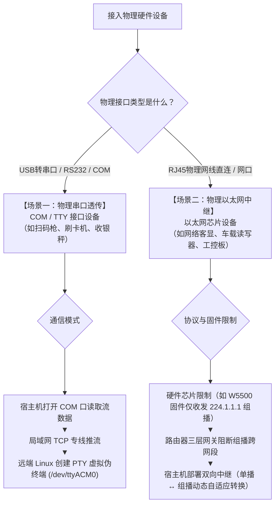

# 硬件设备跨网段网络透传与桥接指南（Hardware Network Bridge）

本指南系统性沉淀了在软硬件联合调试、收银支付系统（如 PosPay）、工控或物联网场景下，如何将连接在本地宿主机（Windows / Linux）上的物理外设（物理串口设备、物理网线直连以太网设备），通过局域网以**无物理穿透卡、零硬件改造、动态自适应**的方式安全透传至虚拟机或远程服务器。

---

## 阶段 0：决策分流与场景判断（Scenario Decision Gate）

面对一个本地连接的物理硬件设备，首先按以下决策树判定通信场景：



| 场景维度 | 场景一：物理串口网络透传 | 场景二：物理以太网设备跨网段中继 |
| :--- | :--- | :--- |
| **典型设备** | 扫码枪、收银POS、刷卡机、客显（串口版） | 网络客显、车载移动支付读写器、单片机W5500 |
| **物理接口** | USB-to-Serial / RS232 / DB9 / COM口 | RJ45 物理网线（通常直连宿主机第二网口） |
| **网络层级** | 字符流 (Stream) 包装为 L4 TCP 连接 | 报文包 (Datagram) L4 UDP 组播/单播互转 |
| **阻断原因** | 虚拟机无物理 COM 映射通道 | 路由器阻断二层组播（224.1.1.1）+ 芯片硬件拒收单播 |
| **核心解决思路** | TCP 套接字 + 远端 Linux PTY 虚拟从设备 | 宿主机部署 UDP 双向中继 + 动态客户端 IP 追踪 |

---

## 阶段 1：场景一 - 物理串口（COM/TTY）网络透传与虚拟串口桥接

### 1.1 核心架构拓扑

```text
+------------------------------------------+                     +---------------------------------------------+
| 宿主机 (Windows / Linux)                  |                     | 虚拟机 / 远程服务器 (Ubuntu / CentOS)        |
|                                          |                     |                                             |
| [物理硬件: 扫码枪/POS/单片机]              |                     |                                             |
|     │ (USB-to-Serial / RS232)            |                     |                                             |
|     ▼                                    |                     |                                             |
| [本地串口: COMx 或 /dev/ttyUSB0]          |                     |                                             |
|     │                                    |                     |                                             |
| [串口网络推流客户端]                      |                     | [虚拟串口桥接服务]                           |
| (PowerShell / Python / socat)            |                     | (监听 9001 -> pty.openpty -> 创建设备节点)  |
|     │                                    |                     |     │                                       |
|     └─── 局域网 TCP 专线 (例如 9001 端口) ───────────────────────────┘                                       |
|                                          |                           ▼                                       |
|                                          |                     [/dev/ttyACM0 或 /dev/ttyS0 虚拟设备]         |
|                                          |                           │                                       |
|                                          |                           ▼                                       |
|                                          |                     [业务进程: pospayservice / 上位机程序]       |
+------------------------------------------+                     +---------------------------------------------+
```

### 1.2 远端 Linux / 虚拟机端（虚拟串口接收端）

在无物理硬件的远端环境，使用 Python 的 `pty`（伪终端）创建虚拟串口对，并软链接为业务程序期望的设备名（如 `/dev/ttyACM0`），监听指定 TCP 端口。

#### 桥接守护脚本：`/opt/PosPay/bridge_serial.py`
```python
#!/usr/bin/env python3
# -*- coding: utf-8 -*-
"""
虚拟串口网络桥接守护脚本
原理：创建 PTY master/slave 对，将 slave 软链为目标设备名，
监听 TCP 端口接收宿主机数据并写入 master，业务程序从 slave 读取。
"""
import os, pty, socket, sys

TCP_PORT = 9001
VIRTUAL_DEV = "/dev/ttyACM0"  # 根据业务配置指定，如 /dev/ttyACM0 或 /dev/ttyS0

def main():
    # 1. 创建虚拟伪终端 (PTY)
    master, slave = pty.openpty()
    slave_name = os.ttyname(slave)
    print(f"[*] 虚拟从设备 PTY: {slave_name}")

    # 2. 建立软链接与权限分配
    if os.path.exists(VIRTUAL_DEV) or os.path.islink(VIRTUAL_DEV):
        try: os.remove(VIRTUAL_DEV)
        except Exception as e: print(f"[-] 清理旧软链接失败: {e}")
    os.symlink(slave_name, VIRTUAL_DEV)
    os.chmod(VIRTUAL_DEV, 0o666)
    print(f"[*] 软链接就绪: {VIRTUAL_DEV} -> {slave_name}")

    # 3. 监听 TCP 端口
    server = socket.socket(socket.AF_INET, socket.SOCK_STREAM)
    server.setsockopt(socket.SOL_SOCKET, socket.SO_REUSEADDR, 1)
    server.bind(("0.0.0.0", TCP_PORT))
    server.listen(1)
    print(f"[*] 正在监听 0.0.0.0:{TCP_PORT}，等待客户端连接...")

    try:
        while True:
            conn, addr = server.accept()
            print(f"[+] 客户端连入: {addr}")
            try:
                while True:
                    data = conn.recv(1024)
                    if not data: break
                    os.write(master, data)
                    print(f"[>] 已注入虚拟串口: {data}")
            except Exception as e:
                print(f"[!] 传输异常: {e}")
            finally:
                conn.close()
    finally:
        os.close(slave)
        os.close(master)
        if os.path.islink(VIRTUAL_DEV): os.remove(VIRTUAL_DEV)

if __name__ == "__main__":
    main()
```

#### 配置 Systemd 守护进程保活：`/etc/systemd/system/bridge-serial.service`
```ini
[Unit]
Description=Scanner Serial Bridge Service
Before=pospayservice.service

[Service]
Type=simple
ExecStart=/usr/bin/python3 /opt/PosPay/bridge_serial.py
Restart=always
RestartSec=2
StandardOutput=journal
StandardError=journal

[Install]
WantedBy=multi-user.target
```
```bash
systemctl daemon-reload && systemctl enable bridge-serial && systemctl restart bridge-serial
```

### 1.3 宿主机端推流（发送端）

#### 方案 A：Windows 原生零依赖 PowerShell 脚本（推荐）
```powershell
$comPort = "COM4"             # 物理硬件在宿主机的实际 COM 口
$baudRate = 115200            # 波特率
$serverIp = "10.30.50.150"    # 远端 Linux/虚拟机 IP
$serverPort = 9001            # 远端监听端口

$serial = New-Object System.IO.Ports.SerialPort $comPort, $baudRate
$serial.ReadTimeout = 500
$serial.Open()
Write-Host "[√] 宿主机串口 $comPort 打开成功！" -ForegroundColor Green

$tcp = New-Object System.Net.Sockets.TcpClient
$tcp.Connect($serverIp, $serverPort)
$stream = $tcp.GetStream()
Write-Host "[√] 成功连接到远端服务器 (${serverIp}:${serverPort})！" -ForegroundColor Green

$buffer = New-Object byte[] 1024
try {
    while ($true) {
        if ($serial.BytesToRead -gt 0) {
            $bytesRead = $serial.Read($buffer, 0, $buffer.Length)
            if ($bytesRead -gt 0) {
                $stream.Write($buffer, 0, $bytesRead)
                $stream.Flush()
            }
        }
        Start-Sleep -Milliseconds 20
    }
} finally {
    $serial.Close()
    $stream.Close()
    $tcp.Close()
}
```

---

## 阶段 2：场景二 - 物理以太网硬件（UDP 组播 ↔ 单播）双向中继代理

### 2.1 问题背景与三大阻断壁垒

当工业硬件（如移动支付车载读写器、网络客显）通过**物理网线直接插在宿主机网卡**上，而测试与业务平台运行在**虚拟机**（不同网段，如 `10.20.9.x` ↔ `10.20.21.x`）中时，会同时面临三道屏障：
1. **组播过不去路由器**：上位机软件使用 `224.1.1.1` 组播寻找设备，局域网路由器默认丢弃跨网段组播；
2. **物理线路隔离**：显示器只插在宿主机网口，机房交换机没有该设备的 ARP/路由；
3. **固件芯片硬件过滤**：如 W5500 硬件芯片工作在 `0x82` 模式（`Sn_MR_MULTI | Sn_MR_UDP`），硬件只接收 `224.1.1.1` 组播，**硬件层面直接丢弃所有单播 UDP**！

### 2.2 解决方案架构：状态化动态中继通道

宿主机作为双向桥梁，运行轻量级中继代理，连接**跨网段单播信道**与**直连网线组播信道**：

```text
[ 虚拟机 / 任意测试机 ]                [ 宿主机 (Windows) ]                 [ 硬件显示器 ]
  IP: 任意 (如 10.20.9.174)           IP: 10.20.21.234                    IP: 10.20.21.222
  运行: MobilePayTestTools             运行: reader_relay_host.ps1         芯片: W5500 (硬件仅收发组播)
          │                                  │                                  │
          │ ─── 跨路由器 L3 单播 UDP ───►   │                                  │
          │     (目标: 10.20.21.234:4000)    │                                  │
          │                                  │ ─── 物理网线 L2 组播 (224.1.1.1:4000) ──►
          │                                  │                                  │
          │                                  │ ◄── 物理网线 L2 组播 (224.1.1.1:4000) ──
          │ ◄── 跨路由器 L3 单播 UDP ───    │                                  │
          │     (动态原路返回客户端)          │                                  │
```

### 2.3 宿主机双向中继核心算法（无死循环、全自动学习客户端）

```powershell
# ==============================================================================
# reader_relay_host.ps1 - 原生 PowerShell 零依赖 UDP 双向组播中继代理
# 特性：
# 1. 自动枚举本机全部网卡，逐一推流直连网线；
# 2. 动态收集本机所有 IPv4 地址，杜绝 Windows 组播反射（Loopback）死循环；
# 3. 按协议命令字（cmd != 0 为请求，cmd == 0 为响应）动态学习客户端 IP/Port，
#    换虚拟机或改 IP 零配置！
# ==============================================================================

$HostIp = "10.20.21.234"
$Port = 4000
$MulticastGroup = "224.1.1.1"

$udpClient = New-Object System.Net.Sockets.UdpClient
$udpClient.Client.SetSocketOption([System.Net.Sockets.SocketOptionLevel]::Socket, [System.Net.Sockets.SocketOptionName]::ReuseAddress, $true)
$udpClient.Client.SetSocketOption([System.Net.Sockets.SocketOptionLevel]::Socket, [System.Net.Sockets.SocketOptionName]::Broadcast, $true)
$udpClient.Client.Bind((New-Object System.Net.IPEndPoint([System.Net.IPAddress]::Any, $Port)))

# 禁用组播回环
$udpClient.MulticastLoopback = $false
$mcastAddress = [System.Net.IPAddress]::Parse($MulticastGroup)

# 动态收集本机全部 IPv4 地址（第一道防线：回环过滤）
$allHostLocalIps = @()
$localIps = @()
Get-NetIPAddress -AddressFamily IPv4 | ForEach-Object {
    $allHostLocalIps += $_.IPAddress
    if ($_.IPAddress -ne "127.0.0.1") {
        try {
            $lip = [System.Net.IPAddress]::Parse($_.IPAddress)
            $udpClient.JoinMulticastGroup($mcastAddress, $lip)
            $localIps += $lip
        } catch {}
    }
}

$mcastEp = New-Object System.Net.IPEndPoint($mcastAddress, $Port)
$bcastEp = New-Object System.Net.IPEndPoint([System.Net.IPAddress]::Broadcast, $Port)
$activeClientEp = $null

Write-Host "[*] UDP 跨网段组播双向中继已就绪，正在监听端口 $Port..." -ForegroundColor Green

try {
    while ($true) {
        $remoteEp = New-Object System.Net.IPEndPoint([System.Net.IPAddress]::Any, 0)
        $receivedBytes = $udpClient.Receive([ref]$remoteEp)
        if ($receivedBytes.Length -lt 4) { continue }

        $srcIp = $remoteEp.Address.ToString()

        # 1. 严格过滤宿主机自身所有网卡产生的数据包（消除反射风暴）
        if ($allHostLocalIps -contains $srcIp) {
            continue
        }

        # 2. 按协议命令字划分角色（第二道防线：状态化动态学习）
        # 请求命令字非 0（如 0xF3 查IP, 0x53 查版本）；响应固定为 0x00 或 0xBB
        $cmdByte = $receivedBytes[2]
        $isRequest = ($cmdByte -ne 0x00 -and $cmdByte -ne 0xBB)

        if ($isRequest) {
            # 动态学习发起方的 IP 与端口
            $activeClientEp = $remoteEp
            Write-Host "[-> 客户端请求] 来自 $($remoteEp.ToString()) 命令: 0x$($cmdByte.ToString('X2'))" -ForegroundColor Cyan

            # 遍历宿主机每一张网卡逐一发送组播（确保无默认网关的直连网线必定发出）
            foreach ($lip in $localIps) {
                try {
                    $udpClient.Client.SetSocketOption([System.Net.Sockets.SocketOptionLevel]::IP, [System.Net.Sockets.SocketOptionName]::MulticastInterface, $lip.GetAddressBytes())
                    [void]$udpClient.Send($receivedBytes, $receivedBytes.Length, $mcastEp)
                } catch {}
            }
            try { [void]$udpClient.Send($receivedBytes, $receivedBytes.Length, $bcastEp) } catch {}
        } else {
            # 捕获物理直连网线上的显示器响应包
            Write-Host "[<- 显示器响应] 来自 $($remoteEp.ToString()) 长度: $($receivedBytes.Length)" -ForegroundColor Green

            if ($null -ne $activeClientEp) {
                # 原汁原味透传回刚才记忆的客户端（保证原始 IP 与 BCC 校验完好）
                [void]$udpClient.Send($receivedBytes, $receivedBytes.Length, $activeClientEp)
                Write-Host "    --> 已精准单播回传给客户端: $($activeClientEp.ToString())" -ForegroundColor Yellow
            }
        }
    }
} finally {
    $udpClient.DropMulticastGroup($mcastAddress)
    $udpClient.Close()
}
```

### 2.4 上位机客户端改造（平滑支持单播跨网段扫描）

在测试工具中保留原有的全网卡组播扫描逻辑，并新增【单播定向扫描】入口：
1. 弹出对话框输入目标宿主机中继 IP（如 `10.20.21.234`）；
2. 发送单播包到中继 IP 端口 4000；
3. 收到应答后提取设备真实信息（IP、MAC、端口）；
4. 后续的版本查询（`0x53`）和设备信息查询（`0xF5`）重载定向到中继 IP 发送，中继自动代为喊话显示器。

---

## 阶段 3：底层网络陷阱与避坑手册（Deep Dive & Troubleshooting）

| 故障现象 / 报错 | 根本原因分析 | 终极解决方案 |
| :--- | :--- | :--- |
| **Windows 报 `Error 5: 拒绝访问`** | Windows 物理串口具有独占锁机制，同一时刻仅允许一个进程打开 | 检查并关闭占用 COM 口的终端（如 MobaXterm、串口助手或旧后台进程）。 |
| **扫码枪扫码有声，但无串口数据** | 扫码枪出厂默认为 USB HID 键盘模式，未开启虚拟串口 | 扫说明书上的“USB Virtual COM（虚拟串口模式）”设置条码切换。 |
| **设备管理器有 USB 设备但无 COM 号** | FTDI 工业转接线未启用虚拟 COM 端口（VCP）驱动 | 设备管理器 -> 右键属性 -> 【高级】 -> 勾选【加载 VCP】并重插。 |
| **中继启动后显示器无任何反应** | **Windows 默认网关跃点数机制**：Windows 发组播默认只发往 Metric 最低、带默认网关的网卡（如 Wi-Fi），直连网线无网关导致空包 | 脚本必须通过遍历 `MulticastInterface` 将组播显式从每一张物理网卡逐个推出去。 |
| **中继控制台狂刷绿字，陷入死循环** | **Windows 协议栈组播反射（Multicast Loopback）**：宿主机多网卡同时监听组播，网卡 B 发出的组播被内核反射回同一 Socket，误以为是新设备回复并反复转发 | 启动时通过 `Get-NetIPAddress` 动态搜集本机所有 IPv4，凡源 IP 属于本机的包一律直接 `continue` 丢弃。 |
| **虚拟机提示“未发现目标设备”** | 1. 响应包送错了回传 IP（如误发给宿主机无线网卡）；<br/>2. 中继尝试改写报文 IP 但破坏了 BCC 校验和导致 Java 端验签失败 | 1. 通过请求命令字动态记录客户端真实 EndPoint；<br/>2. 严禁改动设备回包内容，完整透传原生报文。 |

---

## 阶段 4：生产可用脚本速查与自测清单

### 4.1 脚本目录结构规范
```text
D:\work\材料\tools\script/
├── start_relay.bat        # 一键启动批处理（ANSI编码，直接调PowerShell，免Python环境）
├── reader_relay_host.ps1  # Windows 原生 PowerShell 双向动态中继脚本
├── reader_relay_host.py   # Python 3 备用双向动态中继脚本
├── test_scan_device.ps1   # 宿主机本地组播诊断测试脚本
└── README.md              # 运行手册
```

### 4.2 现场自测诊断步骤
1. **排查网线连通性**：
   在宿主机上运行 `test_scan_device.ps1`，验证物理网线上能否直接收到显示器的 `224.1.1.1` 组播回包。
2. **启动中继服务**：
   在宿主机上右键 `start_relay.bat` 以管理员身份运行，观察是否打印出所有识别到的本地网卡。
3. **发起单播探测**：
   在虚拟机测试工具中点击【单播定向扫描】，填入宿主机 IP，观察宿主机终端：
   * 是否打印 `[-> 客户端请求] 来自 10.20.9.x`？
   * 是否紧接着打印 `[<- 显示器响应] 来自 10.20.21.222`？
   * 是否显示 `--> 已精准单播回传给客户端`？
4. **验证上位机界面**：
   观察虚拟机测试工具界面列表中是否正常展示目标设备 IP、固件版本和设备信息。
