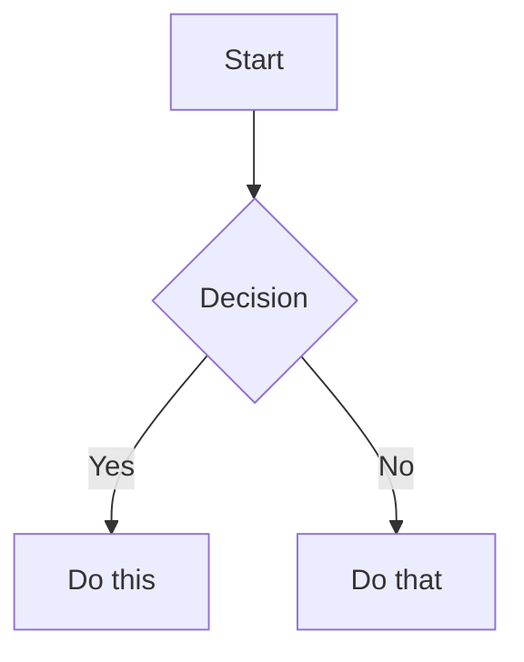

# Obsidian风味的 Markdown 技能

创建和编辑有效的Obsidian风味 Markdown。 Obsidian 通过维基链接、嵌入、标注、属性、注释和其他语法扩展了 CommonMark 和 GFM。该技能仅涵盖Obsidian特定的扩展——标准 Markdown（标题、粗体、斜体、列表、引号、代码块、表格）被假定为知识。

## 工作流程：创建Obsidian笔记

1. **在文件顶部添加带有属性（标题、标签、别名）的 frontmatter**。有关所有属性类型，请参阅 [PROPERTIES.md](references/PROPERTIES.md)。
2. **使用标准 Markdown 结构以及下面Obsidian特定的语法来编写内容**。
3. **链接相关注释** 使用 wiki 链接 (`[[Note]]`) 进行内部库连接，或使用标准 Markdown 链接进行外部 URL。
4. 使用 `![[embed]]` 语法 **嵌入其他笔记、图像或 PDF 中的内容**。有关所有嵌入类型，请参阅 [EMBEDS.md](references/EMBEDS.md)。
5. **使用 `> [!type]` 语法为突出显示的信息添加标注**。有关所有标注类型，请参阅 [CALLOUTS.md](references/CALLOUTS.md)。
6. **验证**注释在 Obsidian 的阅读视图中正确呈现。

> 在 wiki 链接和 Markdown 链接之间进行选择时：对库内的注释使用 `[[wikilinks]]`（Obsidian 自动跟踪重命名），仅对外部 URL 使用 `[text](url)`。

## 内部链接（维基链接）

```markdown
[[Note Name]]                          Link to note
[[Note Name|Display Text]]             Custom display text
[[Note Name#Heading]]                  Link to heading
[[Note Name#^block-id]]                Link to block
[[#Heading in same note]]              Same-note heading link
```

通过将 `^block-id` 附加到任何段落来定义块 ID：

```markdown
This paragraph can be linked to. ^my-block-id
```

对于列表和引号，请将块 ID 放在块后面的单独行上：

```markdown
> A quote block

^quote-id
```

## 嵌入

在任意 wiki 链接前添加 `!` 前缀以内嵌其内容：

```markdown
![[Note Name]]                         Embed full note
![[Note Name#Heading]]                 Embed section
![[image.png]]                         Embed image
![[image.png|300]]                     Embed image with width
![[document.pdf#page=3]]               Embed PDF page
```

有关音频、视频、搜索嵌入和外部图像，请参阅 [EMBEDS.md](references/EMBEDS.md)。

## 标注

```markdown
> [!note]
> Basic callout.

> [!warning] Custom Title
> Callout with a custom title.

> [!faq]- Collapsed by default
> Foldable callout (- collapsed, + expanded).
```

常见型号：`note`、`tip`、`warning`、`info`、`example`、`quote`、`bug`、`danger`、 `success`、`failure`、`question`、`abstract`、`todo`。

有关别名、嵌套和自定义 CSS 标注的完整列表，请参阅 [CALLOUTS.md](references/CALLOUTS.md)。

## 属性（Frontmatter）

```yaml
---
title: My Note
date: 2024-01-15
tags:
  - project
  - active
aliases:
  - Alternative Name
cssclasses:
  - custom-class
---
```

默认属性：`tags`（可搜索标签）、`aliases`（链接建议的替代注释名称）、`cssclasses`（用于样式设置的 CSS 类）。

有关所有属性类型、标记语法规则和高级用法，请参阅 [PROPERTIES.md](references/PROPERTIES.md)。

## 标签

```markdown
#tag                    Inline tag
#nested/tag             Nested tag with hierarchy
```

标签可以包含字母、数字（不是第一个字符）、下划线、连字符和正斜杠。标签也可以在 `tags` 属性下的 frontmatter 中定义。

## 评论

```markdown
This is visible %%but this is hidden%% text.

%%
This entire block is hidden in reading view.
%%
```

## Obsidian特定格式

```markdown
==Highlighted text==                   Highlight syntax
```

## 数学 (LaTeX)

```markdown
Inline: $e^{i\pi} + 1 = 0$

Block:
$$
\frac{a}{b} = c
$$
```

## 图表（美人鱼）

````markdown

````

要将 Mermaid 节点链接到Obsidian笔记，请添加 `class NodeName internal-link;`。

## 脚注

```markdown
Text with a footnote[^1].

[^1]: Footnote content.

Inline footnote.^[This is inline.]
```

## 完整示例

````markdown
---
title: Project Alpha
date: 2024-01-15
tags:
  - project
  - active
status: in-progress
---

# Project Alpha

This project aims to [[improve workflow]] using modern techniques.

> [!important] Key Deadline
> The first milestone is due on ==January 30th==.

## Tasks

- [x] Initial planning
- [ ] Development phase
  - [ ] Backend implementation
  - [ ] Frontend design

## Notes

The algorithm uses $O(n \log n)$ sorting. See [[Algorithm Notes#Sorting]] for details.

![[Architecture Diagram.png|600]]

Reviewed in [[Meeting Notes 2024-01-10#Decisions]].
````

## 参考文献

- [Obsidian 风格Markdown](https://help.obsidian.md/obsidian-flavored-markdown)
- [内部链接](https://help.obsidian.md/links)
- [嵌入文件](https://help.obsidian.md/embeds)
- [标注](https://help.obsidian.md/callouts)
- [属性](https://help.obsidian.md/properties)
