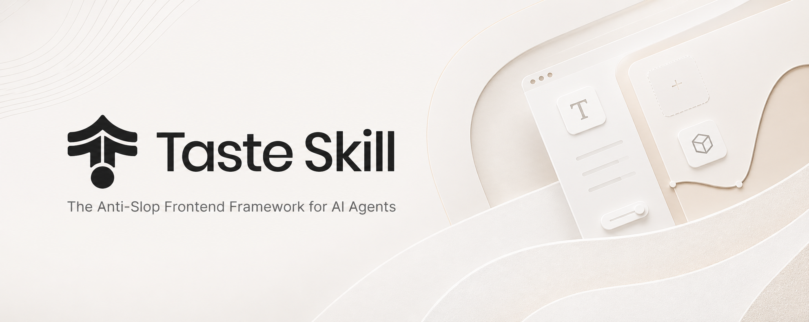
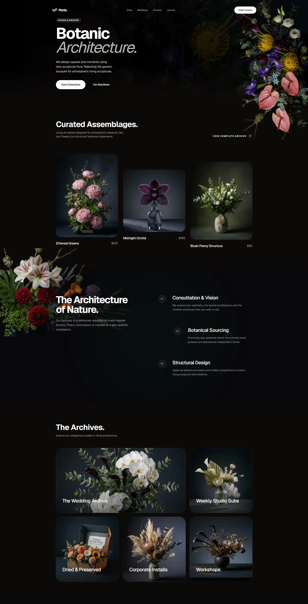
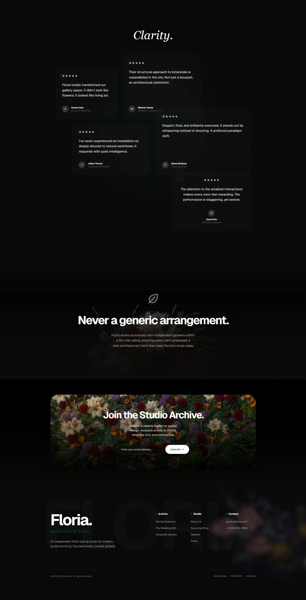

<p align="center">
  
</p>

# Taste Skill

<p align="center">
  <em>AI agent反粗糙前端框架</em>
</p>

<p align="center">
  <a href="https://tasteskill.dev" title="Taste Skill — tasteskill.dev">
    
  </a>
</p>

<p align="center">
  <a href="https://tasteskill.dev">
    
  </a>
</p>

便携式**agent 技能**可升级人工智能构建的界面：更强大的布局、排版、运动和间距，而不是样板式的 UI。该存储库还包括参考板（网络、移动设备、品牌套件）的**图像生成技能**。将它们与 **ChatGPT Images** 或类似的生成器配对，然后将帧交给 Codex、Cursor 或 Claude Code 进行实现。

<p align="center">
<a href="https://github.com/jeettrench/taste-skill/stargazers"></a>
<a href="LICENSE"></a>
<a href="#installing"></a>
<a href="https://www.tasteskill.dev/changelog"></a>
</p>

## 免责声明

Taste Skill 没有官方token、硬币或加密项目。任何使用我的名字、图像或项目的token均与我无关且未经我认可。

<p align="center"><sub><a href="#disclaimer">免责声明</a> · <a href="#installing">安装</a> · <a href="#skills">技能</a> · <a href="#settings-taste-skill-only">设置</a> · <a href="#examples">示例</a> · <a href="#support-the-project">赞助商</a> · <a href="#research">研究</a>·<a href="#common-questions">FAQ</a>·<a href="#license">许可证</a></sub></p>

## 反馈和贡献

我们希望得到您的反馈。建议和错误报告：

- 在 GitHub 上打开 Pull 请求或问题  
- DM [@jeettrench](https://x.com/jeettrench)  
- 给我们发电子邮件 [hello@tasteskill.dev](mailto:hello@tasteskill.dev)

## 安装

[`npx skills add`](https://github.com/vercel-labs/agent-skills) CLI 扫描此存储库中的 `skills/` 文件夹，因此**以下所有技能（代码和图像生成）都以相同的方式安装。**

```bash
npx skills add https://github.com/jeettrench/taste-skill
```

通过**安装名称**安装单个技能（SKILL frontmatter 中的 `name:` 字段，而不是文件夹名称）：

```bash
npx skills add https://github.com/jeettrench/taste-skill --skill "design-taste-frontend"
```

您还可以将任何 `SKILL.md` 复制到您的项目中或将其粘贴到 ChatGPT / Codex 对话中。

## 技能

每项技能只做一项工作；您不需要同时需要所有这些。 **实现技巧**输出代码。 **图像生成技能**仅输出参考图像。

`Install name` 列是您传递给 `--skill` 的确切值。

|技能（文件夹）|安装名称 |描述 |
| --- | --- | --- |
| **品味技巧** | `design-taste-frontend` |优质前端输出的默认全能工具，无需锁定一种狭窄的视觉风格。 |
| **gpt-tastekill** | `gpt-taste` | GPT/Codex 的更严格变体：更高的布局差异、更强的 GSAP 方向、积极的防倾斜。 |
| **图像到代码技能** | `image-to-code` |图像优先管道：生成站点引用，分析它们，然后实现前端来匹配。 |
| **重新设计技能** | `redesign-existing-projects` |现有项目：首先审核 UI，然后修复布局、间距、层次结构、样式。 |
| **软技能** | `high-end-visual-design` |精致、平静、昂贵的UI，具有柔和的对比度、空白、高级字体、弹簧运动。 |
| **输出技能** | `full-output-enforcement` |当模型交付半成品时：完整输出，没有占位符注释。 |
| **极简主义技能** | `minimalist-ui` |编辑产品UI（概念/线性振动），克制的调色板，清晰的结构。 |
| **野蛮技能** | `industrial-brutalist-ui` | ⚠️`BETA` 硬机械语言：瑞士式，鲜明对比，实验布局。 |
| **缝合技巧** | `stitch-design-taste` | Google Stitch 兼容规则，包括可选的 `DESIGN.md` 导出格式。 |

### 图像生成技巧

这些仅产生设计图像（无代码）。与 ChatGPT 图像、Codex 图像模式或任何生成图像的代理一起使用。

|技能（文件夹）|安装名称 |描述 |
| --- | --- | --- |
| **imagegen-前端-web** | `imagegen-frontend-web` |网站组合：英雄、登陆、具有强大排版、间距、防倾斜艺术方向的多部分。 |
| **imagegen-前端-移动** | `imagegen-frontend-mobile` |移动屏幕和流程：iOS/Android/跨平台、模型、可读类型、连贯集。 |
| **品牌套件** | `brandkit` |品牌套件板：徽标方向、调色板、类型、跨类别的标识应用。 |

### 我应该使用哪一个？

- 从**品味技巧**开始，以获得最安全的一般默认设置。  
- 当您想要更严格的 GPT/Codex 导向规则和运动/布局执行时，请使用 **gpt-taste**。  
- 使用**图像到代码技能**进行图像→分析→代码网站工作流程。  
- 使用 **redesign-skill** 来改进现有代码库，而不是新建样式。  
- 当已经选择视觉方向时，添加**软技能**、**简约技能**或**野蛮技能**。  
- 如果代理不断截断输出，则添加 **输出技能**。  
- 当交付物是**图像**（组合、流程、身份板）时，使用 **imagegen-frontend-web**、**imagegen-frontend-mobile** 或 **brandkit**，然后将结果传递给您的编码代理。

### 图像优先提示

对于**图像到代码技能**，请在提示中说明管道，例如：`follow the skill: generate images, then analyze, then code`。

### ChatGPT 图像和 Codex

附加或粘贴 **`imagegen-frontend-web`**、**`imagegen-frontend-mobile`** 或 **`brandkit`** 并询问您需要的帧，然后将渲染提供给 Codex、Cursor 或 Claude Code。当您想要一个既能生成引用又能在代码中实现站点的工作流程时，请使用**图像到代码技能**。

## 设置（仅限味觉技能）

文件顶部的数字是 1-10 的拨号盘：

- **DESIGN_VARIANCE**：布局实验（较低：居中/干净·较高：不对称/现代）。
- **MOTION_INTENSITY**：动画深度（较低：悬停·较高：滚动/磁性）。
- **VISUAL_DENSITY**：每个视口的信息（较低：宽敞·较高：密集的仪表板）。

## 示例

用品味技巧创造：

<p>
  
  
</p>

## 支持该项目

如果品味技巧对您有帮助，请考虑赞助：

[GitHub 上的赞助商](https://github.com/sponsors/jeettrench)

### 当前赞助商

<a href="https://github.com/jeettrench"></a>

<p align="center">
 <a href="https://www.star-history.com/jeettrench/taste-skill">
  <picture>
   <source media="(prefers-color-scheme: dark)" srcset="https://api.star-history.com/badge?repo=jeettrench/taste-skill&theme=dark" />
   <source media="(prefers-color-scheme: light)" srcset="https://api.star-history.com/badge?repo=jeettrench/taste-skill" />
   
  </picture>
 </a>
</p>

## 研究

塑造这些技能的背景写作存在于[`research/`](research/)中。

## 常见问题

**这与其他人工智能设计技能有何不同？**  
多种专业变体、关键技能的可调节旋钮、专门研究得出的防重复规则。所有这些都与主要编码代理的框架无关。

**它可以与 React、Vue、Svelte 一起使用吗？**  
是的。规则针对设计意图，而不是单个框架 API。

**什么是 SKILL.md？**  
便携式指令文件代理，可自动加载；通过 `npx skills add` 或复制到存储库或对话中进行安装。

**图像生成技能是否与 `npx skills add` 一起安装？**  
是的。它们与代码技能一起位于 `skills/` 下，因此相同的 CLI 可以发现它们。

## 许可证

[麻省理工学院许可证](LICENSE) · 版权所有 (c) 2026 jeettrench
