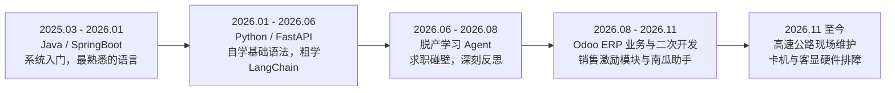

# 2026年个人技术发展总结与真实能力深度复盘

> **写在前面的决心（对自己绝对负责，不作假、不粉饰）：**
> 这份总结是写给我自己看的。技术最怕自己骗自己，借助 AI 辅助写出来的代码，绝不等于完全转化成了自己的内功。我不懂 Netty，没做过高并发消息流，也不会设计复杂的状态机；Python 我只会基础语法，看得懂代码；前端模板组件是在生产环境验证过可用，但全靠 AI 辅助完成，调试耗时长，还没有完全内化形成自己的方法论；数据库热迁移目前只能处理新增表字段和单字段修改。南瓜助手的音频流式重采样、VAD 和声纹核心算法不是我开发的，是我必须要去啃下的硬骨头。承认差距，看清现实，才能在 2027 年真正扎实地蜕变！

---

## 一、我的真实技术轨迹（2025.03 - 2026.11）

回顾这 20 个月的时间，我的技术路径经历了以下几个阶段：

### 1. 2025.03 - 2026.01：Java / Spring Boot 入门（我最熟悉的语言）
- **做了什么**：系统学习 Java 基础语法、面向对象、MySQL 数据库，并用 Spring Boot 写了单体 Web 项目。
- **真实水平**：这是我目前**最熟悉的语言**。能看懂 Spring Boot 现成项目，能写基础 CRUD 接口，能读懂常见的报错堆栈。
- **真实短板**：不会 Netty，不熟悉高并发与复杂锁机制，没做过大规模 JVM 性能调优，工程经验主要停留在单体基础业务。

### 2. 2026.01 - 2026.06：接触 Python、FastAPI 与初探 Agent
- **做了什么**：看到大模型大火，私下自学 Python 语法，用 FastAPI 写了几个小接口，粗略学习 LangChain 调接口。
- **真实水平**：掌握了 Python 基础语法，看得懂代码，能跑起一个简单的 Web 服务接收请求；了解 Prompt、API 调用。
- **真实短板**：对异步底层（asyncio）理解较浅，缺乏大型 Python 项目的独立架构经验。

### 3. 2026.06 - 2026.08：脱产 2 个月冲动学 Agent 与求职撞墙
- **惨痛教训**：以为学会调 API 就能跟上风口，冲动离职脱产学了 2 个月 Agent，结果招聘市场上根本没有初中级“纯 Agent 开发”的岗位。企业要的是算法硕博或 5 年以上架构师，纯调提示词毫无门槛。
- **核心顿悟**：**Agent 绝不能脱离坚实的工程底座和真实的业务实体。单凭一点 Agent 技能根本吃不上饭，它必须作为加分工具！**

### 4. 2026.08 - 2026.11：入职 Odoo ERP 开发 —— 真实业务与二次开发实践
8 月入职新公司后，我参与了基于 Python 的 Odoo 18 系统开发，主要完成了两大核心实践：

#### 4.1 独立开发：销售激励与提成核算模块
在 AI 工具的强力辅助下，我深入调研业务例会决议与政策文件（《大区经理费用支持制度》、《大将酒奖励政策》、《产品提成手册》），主导完成了销售激励模块：
1. **业务规则解构与 DDD 领域建模**：推行单文件单类规范，构建覆盖“合同明细、部件拆分、动态回款流水、抽成比例”的领域模型。
2. **版本化安全动态公式引擎**：
   - 【编译层】：用 Python `ast` 模块解析公式文本，在编译期校验运算符号，通过节点白名单拦截私有属性（如 `__class__`），防范 RCE 与死循环；
   - 【运行层】：剥离危险环境变量，仅通过白名单字典注入清洗后的变量，做好除零和缺失平滑兜底；
   - 【管控层】：重写 ORM `write()` 和 `unlink()`，已发布公式强制不可变（Immutable），规则变更推行写时复制（CoW）绑定新日期。
3. **基于 Owl 3 自研多级树形表格控件**：在 Odoo 18 下定制多级递归树形组件，配合 AI 排查并优化深层响应式与行内实时编辑（Inline Editing）掉帧痛点。
4. **双轨虚拟资金池设计**：“资金费用池（借贷流水）”与“宴请/实物酒额度池（预算扣减）”双轨风控，与销售订单和回款凭证自动勾稽。
5. **数据库平滑迁移**：设计 14 张物理表平滑改名、外键索引重构与元数据热映射脚本，实现新旧系统平滑割接。

#### 4.2 独立二次开发：南瓜助手（AI 会议智能体与流式音频声纹工程系统）
公司有一套会议智能体系统（南瓜助手），我参与了深度的二次开发，**明确权责边界，客观区分既有核心与二次开发成果**：
- **【核心既有功能 · 非我开发 · 我必须系统学习攻坚的两大硬核盲区】**：
  1. **高保真音频流式引擎与 Silero VAD 质量门控链路**：基于凯撒窗（Kaiser Window）+ Sinc 插值 + 多相滤波器（Polyphase Filterbank）的高抗混叠重采样链路；Silero VAD v5（ONNX 引擎）单线程低延迟（~7ms）语音活性门控；SNR 信噪比、截幅比及纯语音比例初筛；`asr_discard` 丢弃与撤销机制。
  2. **多段累计投票决策声纹引擎与会话看门狗**：CAM++ 声纹质量加权质心（Centroid）聚合与动态余弦相似度排位；多段累计加权投票（Multi-Observation Voting）与 Margin 置信度双达标决策；多路麦克风并发管道解耦 Odoo 内核与音频 IO；静音看门狗监控 AudioContext。
- **【本人独立二次开发的核心成果】**：
  3. **两阶段 LLM 录文治理与单调时序任务归集引擎**：
     - 设计 Chunk 分段滑动窗口切片机制，流式调度整理海量原始录文，实现多麦录文融合、口语化降噪与语义纠错；
     - 定义严谨的 MeetingMinutesDTO 与 TaskMatchDTO 领域契约，强类型白名单校验防范模型幻觉；
     - 创新设计“时间序单调正向推进（Monotonic Forward Matching）”算法，融合多轮历史立项时序、责任人锚点与会议时间流向，彻底规避模型大跨度逆流错配，精准关联历史任务或合并新议题。
  4. **高质感 SPA 级前端交互与渲染性能攻坚**：
     - 自研单图层双渐变自适应流光按钮框（Shiny Button Bar）、磁吸胶囊导航栏（Glider Navigation）及悬停光晕组件；
     - 全面消除 `backdrop-filter` 全屏重绘损耗，借助 CSS Houdini `@property` 与 GPU 合成图层实现 60FPS 丝滑触控；
     - 封装高复用待办卡片控件（TodoCardWidget），提供高频悬停联动、异步状态平滑切换与全书看板锚点直达。
  5. **全书知识库 Wiki 深度双向解耦与持久化闭环**：
     - 解耦 MediaWiki 全书看板大表格与例会数据，重构底层物理表（规范 summary、task、todo 主从外键关系指针）；
     - 构建异步后台队列与四态流转引擎，实现纪要与任务自动 Markdown 清洗、Wiki 转译、冲突检测及按锚点精准双向持久化回写。

### 5. 2026.11 至今：调到高速公路现场维护硬件程序
- **做了什么**：11 月被调到高速公路收费车道现场，维护工控机里的卡机（发卡/收卡）与费额显示器（客显屏幕）程序。
- **现状与清醒**：每天面对真实的外设，排查卡纸、掉线、黑屏。前段时间盲目自学 Three.js 试图做炫酷 3D 页面，已及时止损——脱离现场业务的盲目横跳只会空耗精力。

---

## 二、真实技能盘点（对照红笔批注，求真务实）

以下是我对自己真实技术资产的严苛盘点，**绝不吹嘘，诚实面对**：

| 技术维度 | 真实掌握程度 | 实际能做的事情 | 存在的明显不足与攻坚定位 |
| :--- | :--- | :--- | :--- |
| **Java** | **最熟悉的语言** | 能看懂 Spring Boot 现成项目，能写基础 CRUD 接口，能读懂报错堆栈 | **不会 Netty**，不熟悉高并发与复杂锁机制，没做过大规模 JVM 性能调优 |
| **Python 语言工程** | **只会基础语法，看得懂代码** | 掌握基础语法，看得懂代码；能配合 AI 编写实用脚本与服务端业务系统；理解 AST、不可变设计等核心逻辑并能用于实际模块中 | **脱离 AI 独立编写大型复杂底层架构能力欠缺**；对 CPython 源码级 C 扩展未深入研究，对超大规模并发异步网络编程未在生产中涉足 |
| **现代前端（Owl 3 与前端模板组件）** | **`[生产验证可用 · 待完全内化为方法论]`** | **全靠 AI，学习了一点用浏览器排查延迟的方法；能配合 AI 独立编写复杂控件**（如递归树形表格、SPA 流光动效）；手头拥有在生产验证完全可用的高质量前端模板组件资产（`ui-template-gallery` 及南瓜助手控件） | **调试的时间成本很长，没有完全转化成自己的**；缺乏大型独立 SPA（微前端/SSR）架构经验；之前盲目涉猎 Three.js 耗费了精力；**必须花时间将生产验证可用的 AI 组件逆向拆解，沉淀为属于自己的组件设计与性能排错方法论** |
| **架构设计与数据库** | **基础操作与局部设计** | **只能面对新增的表、字段做数据迁移，旧数据最多做单字段的修改**；能理解并落实业务实体建模；有数据一致性与版本快照意识 | 缺乏大型复杂历史数据清洗与迁移经验，缺乏大型分布式分库分表与多数据中心异地容灾实战经验 |
| **业务建模与风控** | **具备良好业务理解** | 具备复杂商业规则标准化解构意识；能将离散制度转化为高内聚领域实体；理解资金池与额度池双轨风控模型 | 领域经验集中在 ERP 销售进销存、激励提成与例会任务流，缺乏金融高频交易等业务经验 |
| **AI / Agent** | **概念理解与工程化落地** | 深入理解 Prompt 结构与 Tool Calling 原理；能设计强类型 DTO 校验契约防幻觉；设计过启发式单调时序任务归集算法 | 没搞过模型底层算法训练与大规模微调；之前脱产学纯 Agent 曾因脱离实际场景而碰壁 |
| **物联网 / 现场硬件** | **刚起步，有实操机会** | 每天能接触真实的工控机、卡机、客显，会看现场日志、查硬件连线、重启排查 | **不懂串口通信协议底层**，不熟悉十六进制报文校验，还没独立手写过硬件通信代码 |

---

## 三、深刻反思：对自己负责的四大认知

1. **AI 是超级杠杆，但不能替代自己的基本功**：
   在 Odoo 销售激励模块和南瓜助手二次开发中，我见识到了 AI 的巨大威力——它能帮我写出 AST 公式引擎、写出 Owl 3 递归树形组件、写出单调时序算法。但我很清楚：**调出来、跑得通，不代表闭着眼睛就能写出来**。我调试花了很多时间，说明底层基本功依然存在欠缺。2027 年必须把这些“借助 AI 跑通的核心经验”一步步内化为自己的真本事！
2. **生产验证可用的前端模板组件，必须转化为自己的自生方法论**：
   手头的前端模板组件（`ui-template-gallery` 及南瓜助手控件）已经在生产环境验证是稳定可用的，这是极度宝贵的“高质量工程样本”。但如果我不去花时间逆向解剖它的数据流、状态机、GPU 渲染图层与重绘损耗，它就永远只是 AI 代工产物。**花时间把生产跑通的组件吃透，总结出组件设计决策树与排障范式，这才是巩固前端的正确道路！**
3. **正视自己的盲区，不冒充架构师**：
   南瓜助手的音频流式重采样（凯撒窗/Sinc插值/多相滤波）、Silero VAD 和 CAM++ 声纹识别，是极其优秀的大牛架构，不是我写的。承认这一点不丢人，反而让我看清了自己向音视频、AI 底层进阶的清晰靶标！
4. **立足当下现场，走软硬件复合的务实之路**：
   我最熟悉的语言是 Java，Python 能配合 AI 解决复杂业务，现在又在高速公路现场面对真实的物理硬件。我不去大厂卷纯后端高并发，我把**现场硬件通信搞懂、把 Python 脚本和 Web 工具写熟、把前端组件沉淀为自生方法论、把南瓜助手的音频与声纹算法攻坚吃透**，这就是不可替代的复合型硬实力！
