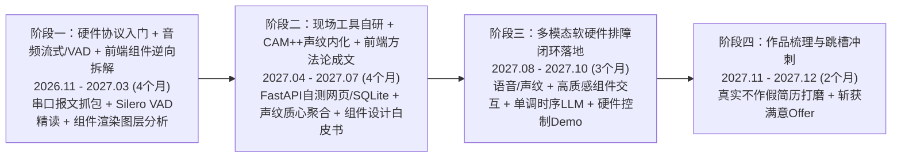

# 2027年个人求真务实技术进阶与突围计划

> **写在前面的军令状（对自己绝对诚实，务求真实、不作假）：**
> 这份计划是写给我自己执行的。我不会 Netty，没做过高并发；Python 我只会基础语法、看得懂代码；数据库热迁移目前只能处理新增表字段和单字段修改。前端模板组件已经在生产环境验证过完全可用，但此前全靠 AI 辅助完成、调试成本高，我必须花时间进行逆向解构，形成属于我自己的组件方法论！南瓜助手的音频流式重采样、Silero VAD 和 CAM++ 声纹核心算法不是我开发的，是我必须要去啃下的硬骨头。
> 2027 年，我绝不背虚假的大厂大词，不搞概念狂热。利用高速现场有机器、有串口的真实环境，配合工作日晚上与周末，把现场硬件搞通，把前端生产组件转化为自生方法论，把南瓜助手的音视频核心算法吃透，把配合 AI 跑通的技能彻底内化为自己闭着眼睛也能讲透的硬功夫！以 2027 年尾为界，实打实打一场翻身仗！

---

## 战役总宣言与时间锚点

- **计划周期**：2026 年 11 月下旬 至 2027 年 12 月底（共约 13 个月，约 400 天）。
- **终局界限**：**以 2027 年尾（2027 年 12 月）为明确的跳槽离职分水岭**。
- **主辅双轨定位**：
  - **主线（现场工程底盘）**：立足高速现场，搞懂串口底层通信与物理外设排障，用最熟悉的 Java 或配合 AI 用 Python 编写轻量可靠的自测小工具与本地数据缓存。
  - **支线一（音视频核心算法攻坚）**：利用业余时间，系统攻坚南瓜助手两大核心硬核功能（高保真音频流式重采样/Silero VAD 门控 + CAM++ 声纹多段投票决策），由浅入深彻底内化为自己的算法资产。
  - **支线二（前端生产组件方法论内化）**：对已在生产验证的前端模板组件库（`ui-template-gallery` 及南瓜助手控件）进行逆向工程拆解，将 AI 代工产物彻底升华为属于自己的《企业级前端复杂交互组件设计与性能排障方法论》！
- **果断止损**：**彻底停掉 Three.js 的学习**。业务完全不沾边，不将有限精力浪费在浮于表面的 3D 特效上，全部压强给现场硬件、音视频核心与前端方法论沉淀。

---

## 一、2027 战略演进路线总览

### 2027 演进四阶段任务与学习规划表

| 阶段 | 时间跨度 | 现场硬件主线（工作时间） | 音视频算法攻坚支线（周一/三/五晚与周末） | 前端组件方法论内化支线（周四晚专项） | 阶段可量化交付物 |
| :--- | :--- | :--- | :--- | :--- | :--- |
| **阶段一** | 2026.11 - 2027.03 (4个月) | **打牢现场硬件基本功**：看懂协议手册，串口助手抓包，写基础 Python `pyserial` 发指令，工控批处理保活 | **攻坚南瓜助手核心第（1）点**：凯撒窗+Sinc插值重采样原理、Silero VAD v5 ONNX 语音门控、SNR/截幅比初筛 | **逆向拆解生产级模板组件**：深入解构 `ui-template-gallery` 与南瓜助手控件，分析状态流转、CSS Houdini 与 GPU 图层合成机制 | 2 个控制卡机和客显的 Python 脚本 + Silero VAD 独立切片工程 + 《前端生产级模板组件逆向拆解手记》 |
| **阶段二** | 2027.04 - 2027.07 (4个月) | **编写车道自测小网页**：用 FastAPI 写自测网页，用 SQLite 搞定新增表/单字段断网离线缓存与重传 | **攻坚南瓜助手核心第（2）点**：CAM++ 声纹特征加权、质心聚合与多段投票决策算法、多麦音频管道与静音看门狗 | **亲手实操并沉淀自生方法论**：在车道自测网页中亲手实践组件化，总结提炼通用决策树，产出自包含方法论白皮书 | 车道设备自测 Web 小工具 + CAM++ 独立测试模块 + **《企业级前端复杂交互组件设计与性能排障方法论》** |
| **阶段三** | 2027.08 - 2027.10 (3个月) | **软硬件协同联动测试**：将自测工具部署至工控机实测，模拟断网拔线、串口异常自愈 | **多模态全链路贯通**：将音频流 VAD + CAM++ 声纹，与自研的单调时序 LLM 录文治理和硬件控制打通 | **高质感前端交互赋能**：运用成熟的方法论为多模态智能体设计高质感交互视窗，具备毫秒级响应与 60FPS 动效 | 本地可演示的“多模态语音交互与车道排障智能小助手”全链路系统（带高质感 SPA 监控面板） |
| **阶段四** | 2027.11 - 2027.12 (2个月) | 整理现场实战排障案例与手册，做好交接准备 | 梳理真实作品集（代码开源或本地演示），实事求是打磨简历，全真模拟面试与投递求职 | 梳理前端组件设计与排障方法论体系，作为前端与全栈面试的降维护城河 | 1 份诚实有深度的黄金简历 + 斩获心仪的物联网/工业软件/智能硬件开发 Offer |

---

## 二、四阶段具体执行细则与准出条件（Exit Criteria）

### 阶段一（2026.11 - 2027.03，4个月）：硬件通信入门 + 南瓜助手音频流式引擎 + 前端组件逆向拆解

#### 1. 现场硬件主线（上班时间利用现场机器）：
- **看懂通信协议手册**：搞懂串口基本参数：波特率（9600/115200）、8-N-1、帧头、命令字、BCC 异或校验和；
- **熟练使用调试助手**：用串口调试助手对着手册敲十六进制报文（如发吐卡指令），观察卡机应答；
- **写出第一段 Python 硬件代码**：用基础语法通过 `pyserial` 写一个 50 行左右的简易脚本：打开 COM 口，发送吐卡/显示指令，读取返回并打印；
- **搞懂进程自启动**：写一个 Windows 批处理（.bat）或守护脚本，卡机程序挂了能自动重新拉起。

#### 2. 南瓜助手核心功能第（1）点攻坚支线（周一/三/五晚与周末）：
> **攻坚目标**：彻底啃下不是自己写的第（1）点——高保真音频流式引擎与 Silero VAD 质量门控链路。
- **重采样数学与代码精读**：搞懂凯撒窗（Kaiser Window）+ Sinc 插值 + 多相滤波器的抗混叠重采样机制；
- **Silero VAD v5（ONNX 引擎）实操**：在 Python 中通过 ONNX Runtime 加载 Silero VAD 模型，跑通低延迟（~7ms）句子级语音活性检测；
- **音频初筛指标代码复现**：亲手写代码计算音频切片的 SNR（信噪比）与截幅比，弄懂 `asr_discard` 丢弃机制。

#### 3. 前端生产级模板组件逆向拆解支线（周四晚 1.5h 专项攻坚）：
> **攻坚目标**：把 AI 辅助写出来、在生产验证可用的前端组件拆解通透，拒绝做“只知其然不知其所以然”的搬运工。
- **逆向拆解 `ui-template-gallery` 与南瓜助手控件源码**：
  - 拆解组件的响应式状态流（Props / State / Events / Composables），画出其内部数据流转图；
  - 搞懂为什么消除 `backdrop-filter` 能消除全屏重绘，学习 GPU 合成图层（`transform: translateZ(0)`、`will-change`）的底层原理；
  - 理解 CSS Houdini `@property` 如何实现自定义属性的类型检查与动画插值，避免触发整个渲染树的 Reflow（重排）；
- **输出阶段成果**：形成一份图文并茂的《前端生产级模板组件逆向拆解手记》。

#### 4. 阶段一准出条件（Exit Criteria）：
- [ ] 能看懂现场卡机/客显协议手册，能用串口助手手动构造报文测试硬件。
- [ ] 拥有自己亲手写的、可稳定运行的 Python `pyserial` 卡机与客显控制小脚本。
- [ ] 脱离南瓜助手系统，能在本地独立用 Python + ONNX Runtime 跑通一段音频文件的 Silero VAD 切片测试。
- [ ] 完成《前端生产级模板组件逆向拆解手记》，能清晰推演出组件的响应式状态流与 GPU 渲染图层原理。

---

### 阶段二（2027.04 - 2027.07，4个月）：编写车道自测小工具 + CAM++ 声纹算法 + 沉淀前端自生方法论

#### 1. 现场小工具主线（将配合 AI 做过的技能彻底内化）：
- **车道设备本地诊断网页**：
  - 此前配合 AI 写过复杂的 Owl 3 与 Vue 3 组件，具备良好的交互感知。这一阶段用 FastAPI 做后端，前端自己亲手构建直观自测面板；
  - 重点练习：**不完全依赖 AI 生成黑盒代码，而是自己动手调试每一个状态与事件**，把浏览器 DevTools 排查延迟和 DOM 渲染的技巧真正转化为自己的肌肉记忆；
  - 面板具备“测试客显显示”、“卡机吐卡收卡”、“串口连接状态心跳”等实用功能。
- **朴素稳健的断网离线缓存**：
  - 根据自己掌握的数据库能力（处理新增表、单字段更新），设计本地 SQLite 数据库；
  - 现场断网时，将交易流水暂存本地 SQLite 单表；网络恢复后，写个简单 Python 定时任务一条条读出补发，确认成功后标记删除。

#### 2. 南瓜助手核心功能第（2）点攻坚支线（周一/三/五晚与周末）：
> **攻坚目标**：彻底啃下不是自己写的第（2）点——多段累计投票决策声纹引擎与会话看门狗。
- **CAM++ 声纹特征与质心聚合精读**：学习音频经过 CAM++ 模型提取 Embedding 向量、L2 归一化与加权质心（Centroid）计算；
- **多段累计加权投票与 Margin 防伪决策算法**：弄懂多段语音特征累加投票机制与第一第二候选人间距（Margin）阈值；
- **并发音频 IO 管道与静音看门狗**：理解音频采集线程与主业务解耦设计，弄懂静音看门狗监控 AudioContext 挂起的保活机制。

#### 3. 沉淀《企业级前端复杂交互组件设计与性能排障方法论》（周四晚与阶段实操）：
> **攻坚目标**：花时间形成自生方法论，将 AI 代工产物彻底升华为个人核心护城河。
- **系统性归纳与成文**：
  - 提炼**组件设计决策树**：何时拆原子组件？Props 与 State 边界如何划分？深层递归组件（如树形表格）如何避免无效重渲染？
  - 提炼**交互性能调优范式**：行内实时编辑（Inline Editing）防抖与焦点管理；GPU 硬件加速与复合图层的开启时机与内存权衡；
  - 提炼**浏览器排障决策路径**：Performance 面板抓火焰图、FPS 掉帧定位、Layer 图层面板排查全屏重绘的实操步骤。
- **输出成果**：正式成文并归档《企业级前端复杂交互组件设计与性能排障方法论》白皮书，作为个人核心知识资产。

#### 4. 阶段二准出条件（Exit Criteria）：
- [ ] 本地自测 Web 小工具能在现场工控机正常跑通，自己能说清楚前端每一个交互按钮与后台调用的对应逻辑。
- [ ] 跑通 SQLite 离线存取与补发逻辑，模拟断网插拔网线，流水不丢失。
- [ ] 能在本地写一个独立的 Python 脚本，调用 CAM++ 提取声纹向量，计算余弦相似度并实现简单的多段投票判断说话人。
- [ ] **完成并归档《企业级前端复杂交互组件设计与性能排障方法论》**，脱离 AI 也能在白板上讲清组件状态流与性能调优链路。

---

### 阶段三（2027.08 - 2027.10，3个月）：打通全链路——打造端侧多模态语音交互与排障智能体

#### 1. 为什么做这个？
在这个阶段，把**阶段一学透的音频流/VAD、阶段二学透的 CAM++ 声纹、自己二次开发成熟的单调时序任务归集、以及内化后的前端高质感交互控件**与现场硬件彻底缝合打通！
这是一个完全属于你自己的、真实可运行的端到端软硬件多模态创新实战项目！

#### 2. 具体攻坚要点：
1. **多模态语音交互与指令解析**：
   - 用户对着麦克风说话（例如“让客显显示交费30元，并让卡机吐一张卡”）；
   - 经过阶段一的 **Silero VAD** 过滤掉翻纸敲桌噪声，提取有效语音；
   - 经过阶段二的 **CAM++ 声纹识别**，识别出说话人是“收费班长”；
   - 语音转文本后，经过自己在南瓜助手中自研的**强类型 DTO 校验与单调时序处理**，解析出标准指令 JSON；
2. **高质感前端看板与硬件联动**：
   - 运用已成型的**前端组件方法论**，打造包含流光状态指示、磁吸胶囊导航与实时日志卡片的高质感本地 SPA 监控视窗；
   - 后台调用串口通信函数，客显屏幕亮起文字，卡机完成吐卡；
   - 若硬件报错，系统自动将报错日志喂给大模型并语音播报排障建议。

#### 3. 阶段三准出条件（Exit Criteria）：
- [ ] 在本地笔记本或工控测试机上，完整演示一遍从麦克风拾音 $\rightarrow$ VAD 切片 $\rightarrow$ 声纹确认身份 $\rightarrow$ 大模型解析指令 $\rightarrow$ 串口硬件动作 $\rightarrow$ 前端 60FPS 实时反馈的完整流程。
- [ ] 系统每一处模块（VAD、声纹、DTO校验、前端组件状态流、串口收发）的原理与代码自己都能完全讲懂、经得起任何技术细节盘问。

---

### 阶段四（2027.11 - 2027.12，2个月）：作品集整理、实事求是打磨简历与跳槽求职

#### 1. 核心目标：
以 **2027 年 12 月为明确界限**，彻底告别盲目横跳，带着实打实内化出来的硬功夫投递求职，斩获心仪的 Offer！

#### 2. 实事求是打磨简历（绝不作假，对自己负责）：
- **坚决不写**：
  - 严禁写“精通 Netty、精通高并发架构”；
  - 严禁写“精通复杂算法训练、精通大型分布式容灾”；
- **重点写出自己的真实优势与稀缺复合性**：
  - **语言与工程底盘**：最熟悉 Java（Spring Boot 基础开发），熟练掌握 Python 业务与脚本开发；**具备扎实的前端复杂交互组件设计方法论与 60FPS 渲染性能排错能力**；
  - **现场硬件与工控实战**：真实接触现场工控机、卡机、客显，熟练掌握串口通信（RS232/485）、TCP/UDP 自定义报文抓包与协议解析，掌握工控程序看门狗与自动保活；
  - **音视频与 AI 工程落地**：
    - 深度掌握音频流式重采样（Sinc插值/多相滤波）、Silero VAD 语音活性检测与质量门控；
    - 深刻理解 CAM++ 声纹特征提取、质心加权与多段投票决策算法；
    - 自主二次开发过大型会议智能体：精通两阶段 LLM 录文治理、强类型 DTO 防幻觉契约，设计过“时间序单调正向推进”任务归集算法；
    - 成功落地基于 Python AST 的动态公式安全沙箱引擎与双轨风控模型。
  - **职业态度**：务实、严谨、排障动手能力极强，善于配合 AI 攻坚复杂技术难题并将其深度内化为自生方法论。

#### 3. 目标岗位与求职行动：
- **目标岗位**：物联网/边缘计算开发工程师、智能硬件/多模态 AI 应用开发、工业软件中级开发、全栈技术支持与研发协同工程师。
- **战役终局**：在 2027 年 12 月底前拿到合适 Offer，体面交接离职，开启职业生涯新篇章！

---

## 三、时间管理与必须坚守的避坑铁律

### 1. 务实的时间分配表

| 场景 | 投入时间 | 具体安排 | 核心原则 |
| :--- | :--- | :--- | :--- |
| **上班现场** | 正常工作时间 | 借着排障多看设备协议手册、用串口助手抓现场十六进制报文、收集真实报错日志 | 把现场当实验室，带着问题去排障 |
| **工作日晚上（周一/三/五）** | 每晚 1 ~ 1.5 小时 | 对照源码精读南瓜助手音视频核心（VAD、重采样、CAM++ 声纹算法）与 Python/Java 练习 | 不求快，每天搞懂一个函数、调通一个测试 |
| **工作日晚上（周四）** | 每晚 1.5 小时 | **前端模板组件方法论专项攻坚**：拆解组件响应式状态流、GPU 合成与性能调优机制，提炼方法论 | 拆透生产可用组件，形成自己的设计决策树 |
| **周末半天** | 周六或周日抽出 3 ~ 4 小时 | 集中精力做模块串联：跑通一次 ONNX 离线推理、测试一次串口收发闭环或前端看板联调 | 保持沉浸式的连贯思考时间 |

### 2. 必须坚守的三条铁律

1. **铁律一：绝不自欺欺人，借助 AI 写出的代码必须彻底搞懂！**
   - 配合 AI 跑通代码只是第一步，必须花时间逐行理解逻辑，搞清楚为什么这么写；
   - 遇到前端掉帧、重采样数学、声纹余弦相似度，必须深入拆解，直到能写出属于自己的方法论。
2. **铁律二：坚决不碰 Three.js 等任何脱离主线的时髦名词！**
   - 2027 年尾前，任何与“现场硬件 + 音视频/AI 算法内化 + 前端组件方法论 + 业务开发”无关的诱惑，一律拒绝。
3. **铁律三：不吹嘘自己不会的东西！**
   - 无论是在总结里，还是在未来的面试中，不会就是不会。靠踏实、诚恳、以及把自己做过的事情讲得入木三分，远比背大厂黑话更能赢得面试官的尊重！
