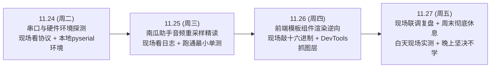

# 2027 阶段一执行计划（预实验阶段：11.24 - 11.27）

> **写在前面的执行原则（张弛有度，拒绝浮躁）：**
> 1. **具体到天，工作日推进**：放假与休息日不安排强行打卡，留出弹性空间；
> 2. **预实验小步验证**：第一周不求搞定大系统，只验证工具环境、找到对应源码、跑通最小的小 Demo；
> 3. **周五晚上绝对不学**：27 号是星期五，辛苦了一周，周五晚上坚决不安排任何学习，彻底休息放松！

---

## 一、预实验作战总览（11.24 - 11.27）



| 日期 | 星期 | 白天现场实操（利用上班与工控机） | 晚上自主时间（每晚 1 ~ 1.5h） | 核心交付物 / 验证指标 |
| :--- | :--- | :--- | :--- | :--- |
| **11.24** | **周二** | **现场硬件与协议摸底**：找现场设备手册，查清卡机/客显使用的波特率、数据位与 COM 端口号 | **Python 串口探测小脚本**：用 Python `pyserial` 编写 20 行脚本，打印当前电脑可用串口列表 | 串口配置参数表 + 本地可跑的串口扫描小脚本 |
| **11.25** | **周三** | **现场日志排查感知**：找到车道工控机软件日志目录，记录一段真实的卡机/客显运行日志 | **南瓜助手音频流代码精读**：定位凯撒窗+Sinc插值重采样源码，理解输入/输出采样率 | 找到南瓜助手音频重采样源文件，跑通一段 5 秒音频转换 |
| **11.26** | **周四** | **串口助手手动发包**：对着手册敲一串报文发给卡机/客显，观察设备反应并记录十六进制回包 | **【前端专项】组件渲染逆向**：用 DevTools Performance 面板录制组件，抓火焰图与 GPU 合成图层 | 记录卡机真实十六进制回包 + 200 字前端渲染逆向手记 |
| **11.27** | **周五** | **现场验证与小结**：将周二写的小脚本放到测试机验证连接，梳理本周现场疑问 | **【强制休息】晚上坚决不学习！** 彻底放松、清空大脑、享受周末 | 本周预实验问题复盘清单（周五晚零负担休息） |

---

## 二、每日逐日详细作战清单

### 11月24日（星期二）· 串口通信与环境就绪预实验

#### 1. 白天现场（利用工作时间）：
- **目标**：搞清楚车道工控机到底连接了哪几个硬件，使用的是哪个 COM 口。
- **动作清单**：
  1. 在工控机打开【设备管理器】 $\rightarrow$ 查看【端口 (COM 和 LPT)】，记下有几个串口（例如 `COM1`、`COM3`、`COM4`）；
  2. 翻看现场的卡机说明书或配置文件，找到通信参数：波特率是多少？（是 9600 还是 115200？数据位 8，停止位 1，无校验？）；
  3. 记在手机或笔记本上。

#### 2. 晚上（1 ~ 1.5 小时，自主学习）：
- **目标**：验证自己的 Python 能够识别电脑的串口。
- **动作清单**：
  1. 在本地电脑命令行运行：`pip install pyserial`（确保库安装成功）；
  2. 新建一个只有 15 行代码的 `test_scan_serial.py`：
     ```python
     import serial.tools.list_ports

     ports = serial.tools.list_ports.comports()
     print(f"[*] 发现可用串口数量: {len(ports)}")
     for p in ports:
         print(f" -> 端口: {p.device}, 说明: {p.description}")
     ```
  3. 运行成功，能看到输出，本晚任务顺利达标！

#### 3. 验收打卡：
- [ ] 知道了现场卡机和客显的 COM 口号与波特率。
- [ ] 本地电脑成功运行 `test_scan_serial.py` 并打印出串口列表。

---

### 11月25日（星期三）· 南瓜助手音频重采样代码精读预实验

#### 1. 白天现场（利用工作时间）：
- **目标**：看懂工控机程序是怎么打印日志的。
- **动作清单**：
  1. 找到工控机卡机程序的安装目录，找到 `logs/` 文件夹；
  2. 打开当天的日志文件，找到卡机正常发卡或异常时的某一行记录，复制 2-3 行样本留存。

#### 2. 晚上（1 ~ 1.5 小时，自主学习）：
- **目标**：不求搞懂全部庞大系统，只找到南瓜助手中做音频重采样的那个具体函数。
- **动作清单**：
  1. 打开南瓜助手源码工程，全局搜索关键字：`resample` 或 `kaiser` 或 `sinc`；
  2. 找到负责音频重采样（如将 48000Hz 转为 16000Hz）的源文件；
  3. 认真精读这个函数的入参和出参：它接收的是什么格式的数据（numpy array 还是 bytes）？
  4. 弄懂一个最核心的数学常识：为什么语音模型（如 Silero VAD / ASR）都要统一降采样到 16kHz？（因为人声的主要能量集中在 8kHz 以内，16kHz 采样率足够保留清晰人声，且能大幅降低模型计算量）。

#### 3. 验收打卡：
- [ ] 收集到了现场卡机真实的运行日志样本。
- [ ] 在南瓜助手源码中定位到了音频重采样的核心函数位置，并搞懂了 16kHz 的必要性。

---

### 11月26日（星期四）· 串口手动发指令 + 前端组件渲染逆向专项

#### 1. 白天现场（利用工作时间）：
- **目标**：用串口助手手动发出一串指令，让硬件有所反应。
- **动作清单**：
  1. 在工控机上打开“串口调试助手”，选择卡机对应的 COM 口和波特率，点击【打开串口】；
  2. 按照手册上的吐卡指令（如十六进制 `02 00 05 31 ... 03`），勾选“十六进制发送”，点击【发送】；
  3. 观察卡机是否有声音或绿灯闪烁，并在接收区观察卡机返回的十六进制字符；
  4. 把这一串收发报文截图或复制下来。

#### 2. 晚上（1.5 小时，周四前端组件专项攻坚）：
- **目标**：逆向拆解一个生产可用组件，用 DevTools 亲眼观察 GPU 渲染。
- **动作清单**：
  1. 打开工作区的 `raw/project/ui-template-gallery` 或者南瓜助手的前端页面；
  2. 在 Chrome 浏览器打开页面，按 `F12` 打开开发者工具，切换到 **Performance（性能）** 面板；
  3. 点击录制，在页面上鼠标悬停一个带流光或动效的卡片组件，录制 3 秒后停止；
  4. 观察火焰图：查看是否有大面积红色的 Long Task（长任务）？页面渲染帧率是不是在 60 FPS？
  5. 切换到 **Rendering（渲染）** 标签，勾选 **Paint flashing（重绘闪烁）**：鼠标滑动时，观察页面是否只有组件局部在闪绿光，背景是否没有全屏重绘？
  6. 写下 200 字的心得：“亲眼看到了 GPU 合成图层如何避免全屏重绘”。

#### 3. 验收打卡：
- [ ] 成功使用串口调试助手完成一次手动收发报文，抓到了真实的十六进制数据。
- [ ] 完成一次 Chrome DevTools 性能录制，亲眼验证了组件局部渲染与 60FPS。

---

### 11月27日（星期五）· 预实验复盘 + 晚上强制休息！

#### 1. 白天现场（利用工作时间）：
- **目标**：把前三天探索的散点串联一下，写一个本周工作小结。
- **动作清单**：
  1. 梳理前三天记录的：COM 口号、波特率、十六进制吐卡报文；
  2. 尝试把十六进制报文填入周二写的 Python 脚本，测试 `ser.write(bytes.fromhex("02 00 ... 03"))` 能否成功发送；
  3. 记录 1 个现场排查卡机时发现的具体疑问（比如：为什么偶尔卡机不应答？是超时时间设短了还是串口被占用？），留作下周攻坚目标。

#### 2. 晚上（绝对不安排学习，彻底休息）：
- **执行原则**：**严格执行休息军令状！**
- 连续工作与探索了四天，周五晚上关闭技术文档，不看代码、不背概念；
- 痛痛快快吃顿好的、看部电影、打打游戏或散步，清空大脑，享受周末；
- 让大脑在放松中沉淀一周的吸收成果。

#### 3. 验收打卡：
- [ ] 整理好了本周现场硬件与代码的试验记录。
- [ ] **周五晚上彻底休息放松，无心理负担！**

---

## 三、预实验成功的标志（11.27 下午自检）

如果在 11 月 27 日下午下班前，能够满足以下 3 点，本次预实验即宣告圆满成功：
1. **真实硬件打通**：知道了现场设备的真实串口与波特率，成功用串口助手收发过一次真实十六进制报文；
2. **源码靶标锁定**：在本地找到了南瓜助手音频重采样代码，明白了为什么要降采样到 16kHz；
3. **前端渲染眼见为实**：用 Chrome DevTools 实际抓了一次生产组件的渲染图层，看懂了什么叫避免全屏重绘。

满足这三点，就为 12 月份全面展开阶段一的日常攻坚奠定了最扎实、最接地气的真实基石！
