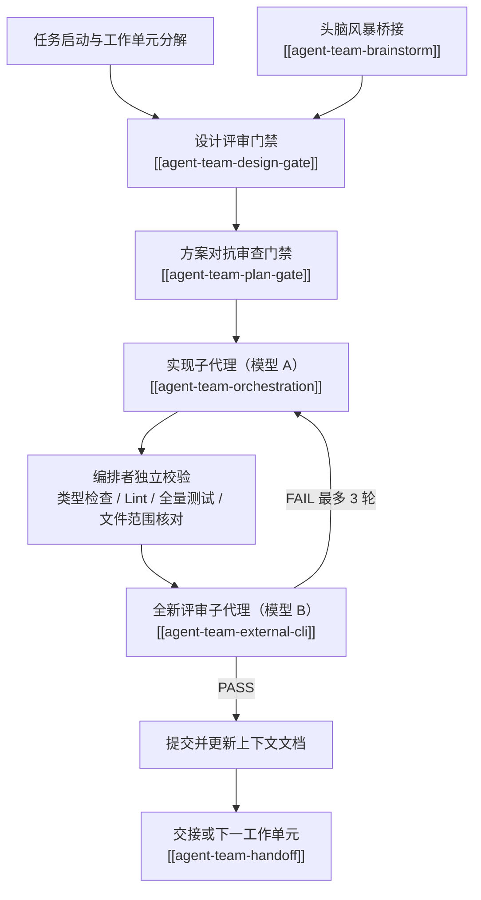

# 多Agent团队协作

面向 **Codex 原生子代理**（`spawn_agent` / `send_input` / `wait_agent` / `close_agent`）的多模型协作协议集合。

本分类的 7 个 skill 是 AI-Wiki 自己的套件，统一使用自有命名前缀 **`agent-team-`**。它们从公开开源编排实践中抽取协作内核——规范驱动、实现者不自证、编排者独立验证、对抗性审查门禁、跨模型委托、零上下文交接——剥离掉原框架的工程外壳（任务库状态机、插件市场、Issue 到 PR 的全自动流水线、多平台适配层），重写为可在 Codex 中直接执行的中文协议，并落盘为可加载的中文 skill 文件。

选型标准只有一条：能不能在 **Codex 原生子代理**上用**不同模型**跑起来。跑不起来的框架专有部分不进入本分类，只在 raw 原始资料层留归档。

## 命名与归属

- 7 个 skill 的目录名、frontmatter `name`、wiki 页 slug 全部使用 `agent-team-*`，不沿用任何上游框架的 skill 名。
- 每个 skill 的正文是中文自研协议，任务落盘、验证方式、门禁裁决都以 Codex 原生能力为准。
- 上游英文原件只作为溯源资料存放在 `raw/SkillHub/zh/metaswarm/original-en/`，不参与导航，也不在 Codex 中加载。

## 本机可用模型

| 模型标识（`spawn_agent` 的 `model`） | 显示名 | 上下文 | 支持的 `reasoning_effort` |
| --- | --- | --- | --- |
| `DeepSeek-V4.1-Flash` | DeepSeek-V4.1-Flash | 256K | `low` / `medium` / `high` / `xhigh` |
| `ccs-glm-5-3-flash/GLM-5.3-Flash` | GLM-5.3-Flash | 1M | `low` / `high` / `max` |

## 分层

| 层级 | 含义 | 处理方式 |
| --- | --- | --- |
| A 级：核心协议 | 已完全脱离上游框架，可直接在 Codex 原生子代理上执行 | 中文 skill 落盘 `raw/SkillHub/categories/multi-agent-orchestration/agent-team-*/SKILL.md`，项目内可加载副本在 `.agents/skills/agent-team-*/SKILL.md` |
| B 级：独立可用 | 不依赖协作闭环，属于独立工具能力，不属于核心协作流程 | 保留蒸馏页，按需单独使用 |
| C 级：框架专有 | 仅对原框架的任务库与插件体系有意义 | 已移出 wiki，中文全译稿与英文原件存于 raw 原始资料层，不在 Codex 中启用 |

## Codex 原生协作流转

核心不变量只有一条：**写代码的模型永远不由自己来审，编排者永远不采信子代理的自述。**

## A 级：核心协议

| Skill | 中文名 | 源文件（raw） | 功能定位 |
| --- | --- | --- | --- |
| [[agent-team-orchestration]] | 四阶段编排执行闭环 | `agent-team-orchestration/SKILL.md` | 实现、编排者独立验证、对抗审查、提交；门禁是阻断式状态跃迁，不是建议 |
| [[agent-team-external-cli]] | 跨模型委托与对抗评审 | `agent-team-external-cli/SKILL.md` | 实现者与评审者分离、模型路由与升级链、自包含 prompt 契约、预算熔断 |
| [[agent-team-plan-gate]] | 计划对抗审查门禁 | `agent-team-plan-gate/SKILL.md` | 计划呈报人类之前的多角色独立对抗审查，二元裁决，全票通过才上呈 |
| [[agent-team-design-gate]] | 设计评审门禁 | `agent-team-design-gate/SKILL.md` | 设计文档定稿前的并行多角色审查，含安全评审与人类升级出口 |
| [[agent-team-brainstorm]] | 头脑风暴桥接 | `agent-team-brainstorm/SKILL.md` | 强制把头脑风暴结论桥接到设计评审门禁，防止跳过架构与安全审查 |
| [[agent-team-handoff]] | 零上下文交接 | `agent-team-handoff/SKILL.md` | 把任务状态固化成自包含文档，交给一个毫无前情的新子代理继续 |

## B 级：独立可用

| Skill | 中文名 | 功能定位 |
| --- | --- | --- |
| [[agent-team-visual-review]] | 视觉审查与页面截屏 | 用 Playwright 对前端页面、组件与幻灯片截图核验；不依赖协作闭环，可单独使用 |

## C 级：框架专有（已移出 wiki）

以下 7 个 skill 仅对 metaswarm 插件体系与 BEADS 工作流有意义，依赖 BEADS 任务库（`bd` CLI）、`gtg` 合并门禁、插件 marketplace、Claude Team Mode 与 GitHub Issue 到 PR 的全自动流水线。2026-10-10 它们已从 `wiki/SkillHub/skills/` 下架，归纳稿移入 raw 原始资料层留存，路径为 `raw/SkillHub/zh/metaswarm/`，不再参与本分类的 wiki 导航、分类计数与图谱。

| Skill | 中文名 | 归档原因 |
| --- | --- | --- |
| `start` | BEADS 多Agent编排总入口 | 入口逻辑建立在 BEADS 任务库与 metaswarm 插件之上，本机无对应物 |
| `setup` | Metaswarm 交互式项目配置 | 为 metaswarm 插件生成项目配置与平台指令 shim，本机不安装该插件 |
| `status` | Metaswarm 安装与配置诊断 | 诊断的是 metaswarm 插件、`bd` 与 `gtg` CLI 的安装状态 |
| `migrate` | Metaswarm 框架迁移与精简 | 处理旧版 npm 内嵌插件到市场插件的迁移 |
| `create-issue` | 自包含 GitHub Issue 生成 | 依赖 GitHub Issue 工作流，本仓库不使用该交付链路 |
| `pr-shepherd` | PR 全生命周期自主监护 | 依赖 GitHub PR、CI 与 `gh` / `gtg` CLI 的持续监护循环 |
| `handling-pr-comments` | 系统化 PR 评审反馈处理 | 依赖 PR 评审线程与 CodeRabbit / Cursor 等外部评审机器人 |

## 使用建议

- **需要跨模型分工的实现任务**：从 [[agent-team-orchestration]] 开始，配套 [[agent-team-external-cli]] 决定哪个模型当实现者、哪个模型当评审者。
- **方案或设计定稿前**：用 [[agent-team-plan-gate]] 与 [[agent-team-design-gate]] 做独立对抗审查；头脑风暴结论经 [[agent-team-brainstorm]] 桥接，不要直接进入编码。
- **上下文即将被压缩或需要换会话**：用 [[agent-team-handoff]] 把状态序列化出去，让全新子代理只读一个文件就能接手。
- **前端界面与幻灯片核验**：用 [[agent-team-visual-review]] 取渲染截图，辅助样式与布局判断。
- **C 级已下架**：7 个框架专有 skill 的归纳稿已移出 wiki，存于 raw 原始资料层（`raw/SkillHub/zh/metaswarm/`）；它们描述的机制在本机不存在，不要按其流程执行。
