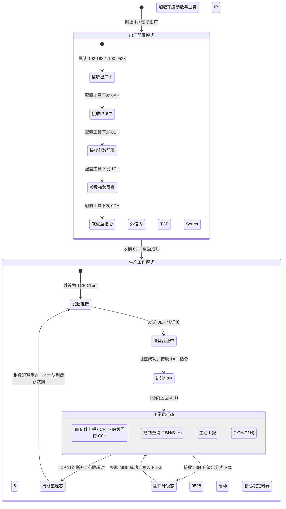

# 车道外设标准化通信协议体系

> 🔗 **关联文档**：
> - 来源依据：[[wiki/references/highway-toll-lane-device-interface-spec|车道设备接口规范（附件3 V1.97）]]
> - 交易流程控制：[[wiki/concepts/rsu-etc-transaction-flow|RSU 路侧单元与 ETC/CPC 交易流程控制]]
> - 机电终端状态机：[[wiki/concepts/self-service-toll-terminal-state-machine|智能自助终端机电控制与状态机]]
> - 综合物联拓扑：[[wiki/synthesis/highway-toll-station-standardization-architecture|收费站标准化试点车道物联网与协同架构全景]]
> - 上级索引：[[wiki/concepts/index|概念索引]]

---

## 1. 协议设计背景与物理传输约束

在高速公路联网收费系统升级与收费站标准化专项试点中，车道内各类感知、控制与交易外设被彻底解耦为标准的 IP 网络节点。

### 1.1 传输层与端口规范
- **物理接口**：标准 RJ45 以太网双绞线，100M/1000M 链路自适应。
- **传输层协议**：TCP（面向连接的可靠字节流），保证指令与交易数据不丢失、保序送达。
- **出厂默认网络参数**：出厂 IP 默认固定为 `192.168.1.100`，监听/业务端口统一为 **`9528`**。
- **数值与字节序**：所有多字节无符号整数均强制采用**大端序（Big-Endian，网络字节序，高位字节在低地址）**。

---

## 2. 统一报文帧结构模型（Frame Format）

协议将所有控制、查询、上报与心跳报文收敛至统一的标准封包结构：

$$\text{Frame} = [\text{STX}] + [\text{VER}] + [\text{SEQ}] + [\text{LEN}] + [\text{DATA}] + [\text{CRC}]$$

```text
+--------------+-------------+-------------+--------------+------------------+--------------+
|  STX (2B)    |  VER (1B)   |  SEQ (1B)   |   LEN (4B)   |     DATA (NB)    |   CRC (2B)   |
|   0xFFFF     |    0x00     |  0x0X/0xX0  | 0x0000 + len | 业务指令与载荷   | CRC16-CCITT  |
+--------------+-------------+-------------+--------------+------------------+--------------+
|<----------------- 协议头 ----------------->|<--- 长度 --->|<--- 载荷内容 --->|<- 校验边界 ->|
```

### 2.1 关键字段语义详解
1. **STX（2 字节）**：帧同步头，固定为 `0xFFFF`，用于接收端在 TCP 流中精准定位帧头、防止粘包与残包错位。
2. **VER（1 字节）**：协议主版本号，当前统一为 `0x00`。
3. **SEQ（1 字节，帧序号步进对齐机制）**：
   - **服务端主动发送帧**：采用 `0XH` 格式（如 `01H, 02H, ..., 09H`），客户端应答帧必须回填完全相同的 `0XH`。
   - **客户端主动上报帧**：采用 `X0H` 格式（如 `10H, 20H, ..., 90H`），服务端应答帧必须回填完全相同的 `X0H`。
   - **自增规则**：主动发送方每次发起新交互时序号自动模 10 累加，在 RSU 等多轮交互会话中，每轮交互帧序号递增 1。
4. **LEN（4 字节）**：DATA 载荷长度。高 2 字节保留固定填 `0x0000`，低 2 字节指示后续 DATA 的实际字节长度 $N$。
5. **DATA（$N$ 字节）**：具体功能指令代码与业务参数，默认以十六进制数组合表达。
6. **CRC（2 字节，CRC16 校验码）**：
   - 校验计算范围：**从 VER 字节开始，贯穿 SEQ、LEN 直至 DATA 最后一个字节**。
   - 多项式：采用逆序低位在先多项式 `0x8408`（对应生成多项式 $X^{16} + X^{12} + X^5 + 1$）。
   - 初始值：`0xFFFF`，最终异或取反 `(~crc) & 0xFFFF`。

---

## 3. 双运行模式生命周期状态机

标准化规范将车道设备的运行期划分为互斥且单向流转的两个状态空间：



### 3.1 核心状态流转规则
- **角色反转设计**：
  - 在配置阶段，外设必须扮演 **TCP Server**，允许运维工程师携带便携电脑直连调试；
  - 一旦参数固化重启进入工作模式，外设立即自动反转为 **TCP Client**，主动向站级系统集群发起建链，实现站级集中管控与动态负载接入。
- **5 秒心跳保活与故障感知**：
  - 监控上报指令 `0CH` 以精确的 5 秒为周期向服务端发送全局运行状态（正常 `00H` / 异常 `01H`）、内存使用率、设备温度以及各模块专属个性化参数。
  - 连续 3 次未收到服务端 `C0H` 确认即判定站级链路失联，外设切入本地自持脱机缓存态。

---

## 4. 寻址模型与多模块一体化调度

车道物联设备存在两类典型形态：**单功能独立外设**（如独立雾灯）与**多功能一体化外设**（如多功能栏杆一体机集成栏杆机、费显、红绿灯与报警器）。

### 4.1 统一寻址双元组
每个功能单元在协议层以 `DeviceType` + `DeviceIndex` 唯一标识：
- `DeviceType`（1 字节）：取值自标准外设功能编码（`E1H ~ F4H`）。
- `DeviceIndex`（1 字节）：同一物理车道内同类型模块的自增序号（`01H, 02H, 03H...`）。

### 4.2 控制查询帧（1BH / B1H）多路复用模型
当服务端需要对一体机的多个部件同时下达控制时，无需建立多条 TCP 连接，而是采用统一聚合封装：

```text
[1BH 请求帧]
├── CmdType: 1BH
├── UnixTime: 8 字节毫秒时间戳
├── LaneHex: 5 字节车道唯一编码
├── CertificationInfo: 8 字节安全认证码
├── Reserved: 2 字节保留 (0x0000)
├── DeviceNum: 1 字节 (表示包含 N 个模块指令)
└── 模块子帧序列:
    ├── 模块 1 长度 (2B) + 模块 1 控制指令内容 (如 E4H 栏杆抬杆 01H)
    ├── 模块 2 长度 (2B) + 模块 2 控制指令内容 (如 E6H 费显文字 01H)
    └── ...
```

设备端执行完毕后，原样回包 `B1H` 响应帧，包含各模块的执行状态代码，实现单次 TCP 握手完成原子级车道动作联动。

---

## 5. 异常分级与容错兜底机制

规范在附录 A.2 与各章节中确立了完备的异常处理规范：
1. **时钟同步防漂移**：车道外设必须通过 NTP/北斗授时与站级系统保持时间对齐。若时差 ≥ 10 分钟，立即触发 `10H` 时钟同步异常。
2. **本地防爆队列**：当牌识流水积压 $\ge 1000$ 条（异常码 `11H`）或图片累积 $\ge 1000$ 张（异常码 `1AH`）时，外设报警并自适应减缓非关键传输，优先保证收费核心数据不丢。
3. **断点升级与 MD5 强一致校验**：升级包下载（`53H/B3H`）支持分片并发传输，升级完成后必须在固件内校验 32 字节 ASCII 格式的 `UpdateMD5`，校验失败立即丢弃，防止刷入破损固件引发硬件死锁。
