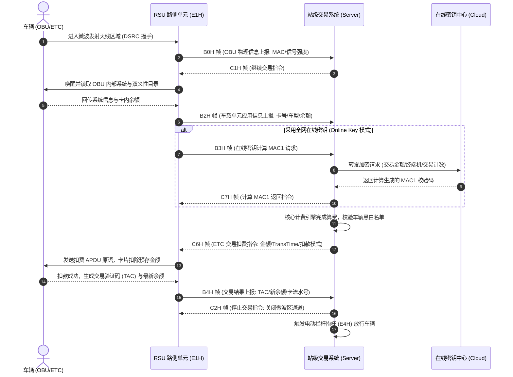
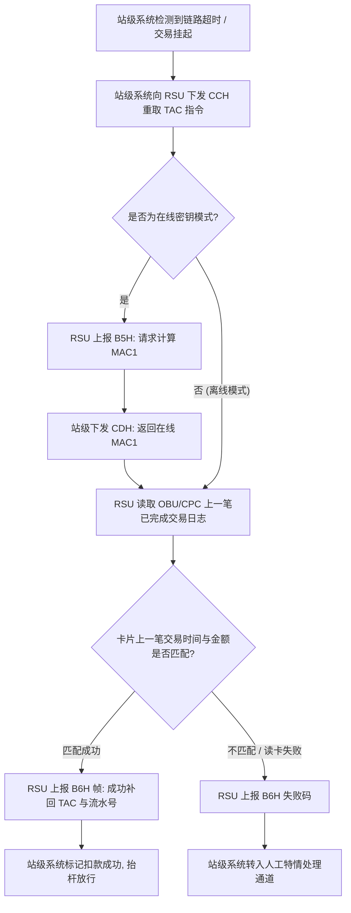

# RSU 路侧单元与 ETC/CPC 交易流程控制

> 🔗 **关联文档**：
> - 来源依据：[[wiki/references/highway-toll-lane-device-interface-spec|车道设备接口规范（附件3 V1.97）]]
> - 基础通信协议：[[wiki/concepts/highway-toll-lane-device-protocol|车道外设标准化通信协议体系]]
> - 综合物联拓扑：[[wiki/synthesis/highway-toll-station-standardization-architecture|收费站标准化试点车道物联网与协同架构全景]]
> - 上级索引：[[wiki/concepts/index|概念索引]]

---

## 1. RSU 路侧单元架构与通信模式

RSU（Road-Side Unit，外设功能模块编码 **`E1H`**）是车道实现 ETC 自由流与半自动收费的关键微波射频终端。其通过 5.8GHz DSRC（专用短程通信）与车载单元 OBU（On-Board Unit）及 CPC 卡进行双向高频交互。

### 1.1 两种工作架构模式
规范支持两种部署架构，由初始化指令 `1AH` 中的 `WorkMode` 参数决定：
- **集成模式（Integrated Mode，WorkMode = 01H）**：
  - RSU 固件内嵌交易状态机，路侧单元自身负责执行 5.8GHz 链路层通信、防碰撞寻道、PSAM 卡指令组装与报文解析。
  - 站级交易系统只需下达高阶语义指令（如 `C1H 继续`、`C6H 扣款`、`C2H 停止`）。绝大多数标准化车道优先采用此模式。
- **透传模式（Transparent Mode，WorkMode = 02H）**：
  - RSU 退化为纯射频物理收发调制解调器，所有 DSRC 应用层 APDU 原语直接通过网络透传至站级交易引擎。

---

## 2. PSAM 卡授权与安全加密底座

ETC 交易具有极高的金融级安全要求，RSU 必须配备物理 PSAM（Purchase Secure Access Module）卡，规范支持 **3DES（00H）** 与 **国密 SM4（04H）** 双密码算法体系。

### 2.1 离线密钥 PSAM 授权流程
在系统初始化完毕后，站级系统必须先对 RSU 卡槽内的 PSAM 卡执行权限激活：
1. 服务端下发 `CBH`（读写器 PSAM 授权指令），携带终端机序列号、时间戳与授权密文。
2. RSU 内部向指定槽位的 PSAM 卡发送 TimeCos 认证指令。
3. PSAM 返回 `9000H` 状态码即代表授权成功，RSU 上报 `BBH` 确认帧。

---

## 3. 标准交易流程控制时序

在集成模式下，一次标准 ETC 电子不停车扣款交易包含严密的状态时序流转：

### 3.1 关键交互节点深度说明
1. **B0H 物理上报与天线防串扰**：
   - 当多车贴近时，RSU 会根据天线信道功率等级检测信号衰减度。只有当物理层确认车辆进入核心扣费区时，才向站级上报 B0H。
2. **TransTime 时间戳同步**：
   - 2024/06 修订中将历史遗留的 `PurchaseTime` 统一修正为 `TransTime`，该时间戳用于参与 PSAM 卡内 MAC1 离散运算，杜绝交易重放攻击。
3. **TAC（Transaction Authentication Code）交易防伪认证码**：
   - 扣款完成后卡片输出的 4 字节 TAC 是省级乃至部级清分结算平台认可这笔通行费被合法扣除的唯一加密凭证。

---

## 4. 异常掉电与网络中断容错：重取 TAC 幂等恢复机制

在车道生产环境中，最严重的边缘异常是：**RSU 已向车载卡片发出了扣款指令，司机卡片已被实际扣除通行费，但瞬间车道突发掉电或以太网交换机闪断，导致 B4H 交易结果未送达站级系统**。

若车道盲目重扣，会导致司机投诉严重的“二次扣款”；若直接放行，则造成通行费流失。为此，规范在第 7.1.6 节与 7.3.1.5 节定义了严密的**重取 TAC 幂等恢复状态机**：

### 4.1 恢复机制核心价值
- **交易原子性保障**：通过 `CCH -> B5H -> CDH -> B6H` 的状态闭环，使车道端在不重新向卡片发生金融扣款的前提下，能够以读取交易历史明细的方式找回 TAC 凭据。
- **全网数据对齐**：找回的 TAC 与原始交易流水号完全一致，确保站级交易系统在上传省联网收费平台时不会因凭证缺失被结算中心拒收。
