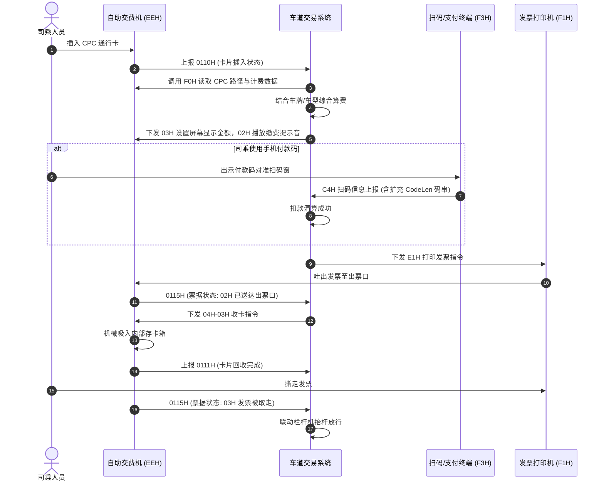

# 智能自助发卡与交费终端机电控制与状态机

> 🔗 **关联文档**：
> - 来源依据：[[wiki/references/highway-toll-lane-device-interface-spec|车道设备接口规范（附件3 V1.97）]]
> - 基础通信协议：[[wiki/concepts/highway-toll-lane-device-protocol|车道外设标准化通信协议体系]]
> - 综合物联拓扑：[[wiki/synthesis/highway-toll-station-standardization-architecture|收费站标准化试点车道物联网与协同架构全景]]
> - 上级索引：[[wiki/concepts/index|概念索引]]

---

## 1. 终端机电拓扑与双工位分体架构

在“无人值守收费站 / 智慧云收费站”演进过程中，自助发卡机（模块编码 **`EDH`**）与自助交费机（模块编码 **`EEH`**）承担了替代人工收费员与司乘进行实体 CPC 卡交互的核心职责。

### 1.1 双工位空间立体适配
针对公路货车驾驶座普遍高于普通小客车的物理客观现实，终端内部在机械上被抽象为独立的双工位：
- **上工位（Mid = 01H）**：高位机械臂，面向大型货车、集装箱卡车司乘。
- **下工位（Mid = 02H）**：低位机械臂，面向一型/二型普通轿车司乘。
- **公共状态（Mid = 00H）**：针对与具体工位无关的全局机柜环境（如温湿度、水浸、对讲按键）。

### 1.2 四通道机芯矩阵（Mno = 01H ~ 04H）
每个工位内部包含多路走卡通道与卡仓，支持独立的通道状态感知与分流电机控制。

---

## 2. 自助发卡状态机（EDH 入口车道业务）

入口无人化发卡机的核心目标是**极致压缩车辆发卡停顿时间（做到进站即拿卡）**。其流转状态机如下：

```mermaid
stateDiagram-v2
    [*] --> 怠速待命: 卡仓余量正常 (0001H)
    
    怠速待命 --> 预备卡状态: 车辆压前线圈 / 存在线圈触发
执行 04H-01H 备卡指令
    预备卡状态 --> 读写工位到位: 卡片送达 0224H (卡到读写区域)
    
    state 读写工位到位 {
        [*] --> 写入入口信息: 非接读写器 (F0H) 写入站点与时间
        写入入口信息 --> 校验合法: 读回 CPC 序列号与内容
        写入入口信息 --> 读写失败: 等待超时 0223H / 芯片异常
    }
    
    读写失败 --> 坏卡回收: 执行 04H-04H 回收坏卡
    坏卡回收 --> 废卡箱: 上报 0222H (回收坏卡成功)
    废卡箱 --> 预备卡状态: 重新分发下一张卡片
    
    校验合法 --> 伸出吐卡: 司乘按下物理取卡键 0220H
执行 04H-02H 发卡指令
    伸出吐卡 --> 司机取走: 上报 0221H (发卡成功)
上报 0225H (卡片被正常取走)
    
    司机取走 --> 抬杆放行: 联动电动栏杆 (E4H) 抬杆
重置状态机为待命
```

### 2.1 备卡（Pre-Stage）并发优化机制
- 传统发卡需要司乘按键后才从深层卡仓抓卡、机械传送到射频区、写卡、再吐卡，耗时长达 3~5 秒。
- 标准化接口通过“提前备卡指令（04H 子功能 01H）”，在车辆触发抓拍线圈时，即在读写区预热写入完成，司机伸手按键毫秒级吐卡，通行效率提升 60% 以上。

---

## 3. 自助交费状态机（EEH 出口车道业务）

出口交费涉及“插卡 -> 计费 -> 支付 -> 出票 -> 收卡/退卡”的多外设联动：



---

## 4. 特情告警与远程运维处置闭环

规范在附录 A.2 与 B 中定义了严密的异常代码与处置流程：

| 故障类别 | 状态码 / 异常码 | 物理成因与表现 | 自动化容错与站级处置动作 |
| :--- | :--- | :--- | :--- |
| **卡槽夹卡** | 状态类型 `0007H`，数据值 `0001H` | CPC 卡变形或机械传动皮带打滑导致卡片卡滞在轨道中 | 1. 触发 `0002H`（需人工介入）；<br>2. 自动切换至备用机芯通道；<br>3. 站级监控大屏红框告警并指派外场人员。 |
| **工位缺卡** | 状态类型 `0226H` | 司机按键，但对应工位卡仓余量归零 | 1. 自动下发语音提示引导司机使用另一工位；<br>2. 触发站级卡仓补卡工单。 |
| **打印机卡纸/缺纸** | 异常编码 `24H/25H`（上）/ `27H/28H`（下） | 卷式热敏发票耗尽或切刀卡死 | 1. 自动引导司机扫描屏幕二维码开具“电子发票”；<br>2. 允许免纸质票放行，杜绝堵塞车道。 |
| **面板伸缩阻挡** | 异常编码 `37H`（面板伸出失败） | 机械臂触碰反光镜或车身障碍物（扭矩超标保护） | 1. 电机瞬时自锁并自动缩回安全距离；<br>2. 播放语音提示司乘靠近取卡。 |
| **远程对讲求助** | 状态类型 `0004H`（求助按键）+ `0006H` | 司乘遇到疑问按下求助呼叫按键 | 1. 站级音视频座席自动弹出该车道监控画面；<br>2. 建立双向高清对讲，支持站务人员远程强制吞卡/吐卡或代客缴费。 |
