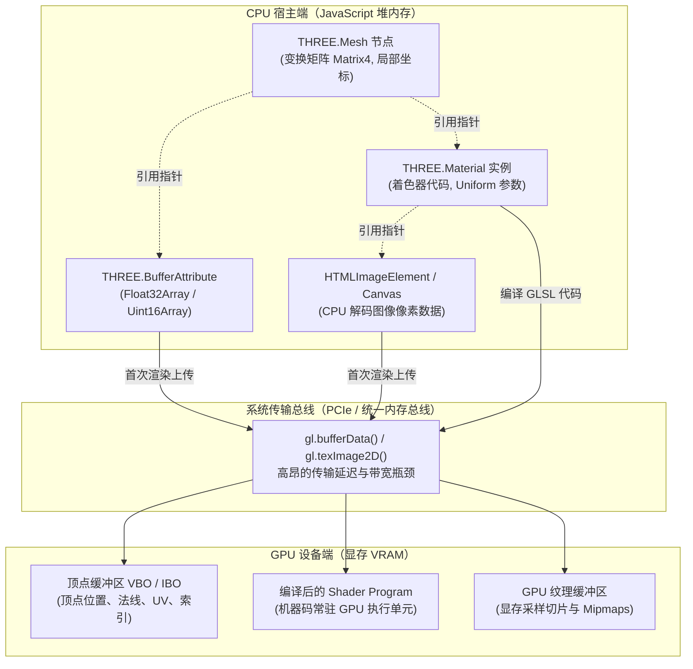
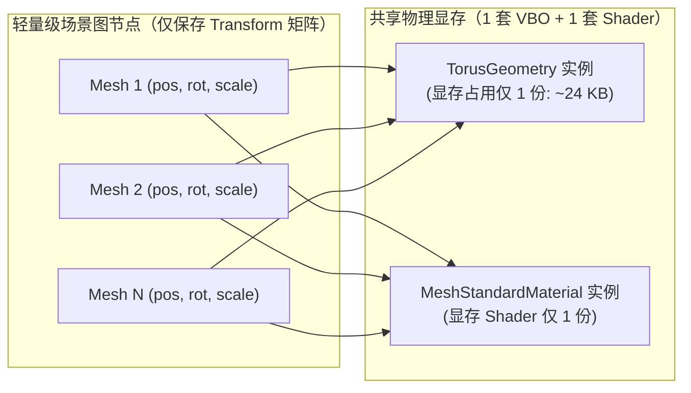
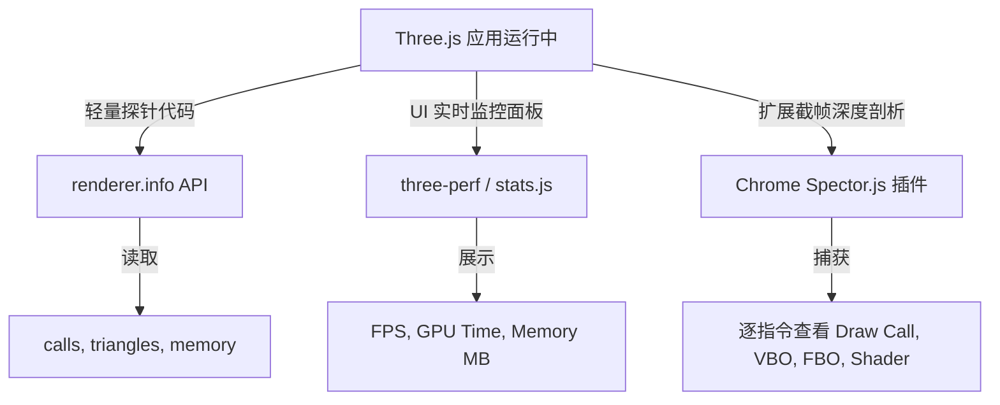

# Three.js 几何体与材质显存复用模式与性能开销白皮书

> 🔗 **关联文档**：本白皮书提炼自 [[wiki/synthesis/threejs-journey-learning-path|Three.js Journey 每日 2 小时自学路径]]（特别是 Day 11 散布资产与 Day 29 性能优化篇），并与实际项目代码 [[raw/project/demo/src/main.ts|src/main.ts]] 的海量散布甜甜圈场景形成正反例对照。上一级索引参见 [[wiki/references/index|来源摘要索引]]。

---

## 1. 背景与底层架构：CPU 堆内存 vs GPU 显存（VRAM）数据流转

在现代浏览器中开发 Web 3D 应用程序时，核心挑战在于驾驭 **CPU（宿主端，Host）** 与 **GPU（设备端，Device）** 两个物理异构计算单元之间的协同与数据同步。理解二者的内存分界与通信成本，是写出高性能 Three.js 程序的理论基石。



### 1.1 三维网格的底层解构：JS 对象指针与 GPU 物理缓冲

在 Three.js 中，一个渲染网格模型由 `THREE.Mesh = Geometry + Material` 组合而成，但这三者在内存中的分工迥异：

1. **`THREE.Mesh`（轻量级逻辑外壳）**：
   - 本质是场景图（Scene Graph）中的空间定位节点，继承自 `THREE.Object3D`。
   - 它在 JavaScript 堆内存中主要维护局部变换矩阵（`position`, `rotation`, `scale`）和世界变换矩阵（`matrixWorld`）。
   - 它**不存储**具体的顶点三维坐标数组，仅持有对 `BufferGeometry` 和 `Material` 的内存指针引用。
2. **`THREE.BufferGeometry`（顶点数据载体）**：
   - 内部包含多个 `THREE.BufferAttribute`，由原生的 JavaScript 定型数组（TypedArray，如 `Float32Array` 存储顶点、法线、UV，`Uint16Array`/`Uint32Array` 存储三角面索引 index）构成。
   - 当调用 `renderer.render(scene, camera)` 时，Three.js 的 `WebGLGeometries` 模块会检查该几何体。若为首次渲染或标记了 `needsUpdate = true`，Three.js 会调用 WebGL 底层 API（`gl.createBuffer()`、`gl.bindBuffer()`、`gl.bufferData()`）将这些二进制数据完整拷贝上传至 GPU 显存，生成物理存在的 **VBO（Vertex Buffer Object，顶点缓冲区对象）** 和 **IBO/EBO（Index Buffer Object，索引缓冲区对象）**。
3. **`THREE.Material`（着色管线与外观配置）**：
   - 描述物体的光照模型与光学材质特性。
   - 在底层映射为 WebGL 的 **Shader Program（着色器程序）** 及运行期状态（深度测试、混合模式、面剔除）。纹理贴图则通过 `gl.createTexture()` 与 `gl.texImage2D()` 拷贝至 GPU 纹理显存单元。

### 1.2 PCIe 总线传输瓶颈与数据常驻范式

为什么 GPU 必须一次性把顶点和纹理全部吞入显存，而不是在每一帧渲染循环中从 CPU 实时读取？

- **物理带宽悬殊**：GPU 内部显存总线带宽可达 **数百 GB/s 至数 TB/s**（如 GDDR6 / HBM3），而 CPU 与独立 GPU 之间的系统通信总线（PCIe 3.0/4.0/5.0）带宽仅有 **十几 GB/s 到几十 GB/s**，在集成显卡或移动设备 SoC 上也是共享内存带宽。
- **通信延迟（Latency）与上下文开销**：每一次从 CPU 向 GPU 发起数据传输（`gl.bufferSubData` 或 `gl.texSubImage2D`），都伴随着驱动层的安全校验、内存映射与流水线等待（Pipeline Stall）。

> [!IMPORTANT]
> **WebGL 核心架构范式**：**“初始化时一次性上传，运行期常驻显存，每帧仅发送绘制指令与少量 Uniform 矩阵变换”**。如果打破这一范式在运行期频繁申请新显存或回传数据，总线传输与驱动瓶颈将直接导致主线程丢帧。

---

## 2. 反模式深度剖析：循环体内实例化（new Geometry / Material）的四重灾难

在初学 Three.js 或大批量渲染场景（如粒子、散布灌木、漂浮物、点位标注）时，最典型的反模式莫过于**在循环体内重复实例化几何体与材质**：

```typescript
// ❌ 极度危险的反模式：循环体内疯狂 new 几何体与材质
for (let i = 0; i < 1000; i++) {
  const geometry = new THREE.TorusGeometry(0.25, 0.12, 16, 32);
  const material = new THREE.MeshStandardMaterial({ color: 0xffaa00 });
  const mesh = new THREE.Mesh(geometry, material);
  mesh.position.set(Math.random() * 10, Math.random() * 10, Math.random() * 10);
  scene.add(mesh);
}
```

这种看似直观的代码会迅速引发连锁反应，带来**四重系统级灾难**：

### 灾难一：GPU 显存暴涨与 OOM（Out of Memory）崩溃
以一个精细度一般的圆环面 `TorusGeometry(0.25, 0.12, 16, 32)` 为例：
- 顶点数：$(16 + 1) \times (32 + 1) = 561$ 个顶点。
- 顶点属性：
  - `position`：$561 \times 3 \times 4\text{ 字节} \approx 6.73\text{ KB}$
  - `normal`：$561 \times 3 \times 4\text{ 字节} \approx 6.73\text{ KB}$
  - `uv`：$561 \times 2 \times 4\text{ 字节} \approx 4.49\text{ KB}$
- 三角面索引：$16 \times 32 \times 2 \times 3 \times 2\text{ 字节} \approx 6.14\text{ KB}$
- **单个几何体显存占用**：约 $24.1\text{ KB}$。

若在循环中实例化 1,000 个，几何体直接吞噬 **24.1 MB** 显存；若是 10,000 个复杂模型或带多张 2K 贴图的材质，显存瞬间被撑爆几百 MB 至数 GB。在移动端 iOS Safari（显存限额通常只有数百 MB）或低配 PC 上，浏览器会直接触发 `webglcontextlost` 事件，导致画布瞬间白屏并彻底崩溃。

### 灾难二：JavaScript 垃圾回收（GC）引起的规律性微卡顿（Frame Stutter）
循环内每轮迭代产生独立的 `TorusGeometry`、`MeshStandardMaterial`、`Mesh` 及其内部嵌套的 `EventDispatcher`、`Vector3`、`Box3`、`Sphere` 等数十个微小对象。
- 1,000 个网格意味着瞬间在 V8 引擎的新生代堆（Young Generation）中分配了数万个微对象。
- V8 垃圾回收器被频繁唤起执行 Scavenge 回收，随后大批对象存活并晋升至老生代（Old Generation），触发耗时更长的 Full Mark-Sweep（全局标记清除）。
- **现象**：浏览器主线程出现持续 50ms~200ms 的长任务阻塞（Long Task），帧率出现每隔 2~3 秒一次规律性的断崖式跳水（60 FPS $\to$ 15 FPS $\to$ 60 FPS），带来极其糟糕的交互卡顿感。

### 灾难三：着色器重复编译与 Uniform 状态切换冗余
Three.js 对材质有着严格的程序哈希校验机制。每个新 `new THREE.MeshStandardMaterial()` 即使参数一模一样，其唯一标识 `uuid` 也是独立的：
- 在底层 WebGL 渲染管线执行渲染队列前，必须频繁切换状态机：调用 `gl.useProgram(program)`、重新绑定当前材质对应的 Uniform 缓冲区、重新设置深度与模板测试参数。
- 这种 CPU 驱动层到 GPU 命令流的高频上下文切换（Context Switching Overhead）极其昂贵，完全破坏了现代 GPU 批处理流水线的连续性。

### 灾难四：Draw Calls 绘制调用次数急剧攀升
每个独立的 Mesh 拥有独立的材质和几何体缓冲，Three.js 无法对其进行管线合并，必须针对每个物体独立分发一次 `gl.drawElements()` 或 `gl.drawArrays()`。
- 1,000 个物体 = 1,000 次 Draw Calls。
- Web 浏览器的单帧绘制调用通常建议压降在 **100 次以内**（移动端建议小于 50 次）。1,000 次甚至上万次 Draw Calls 会让 CPU 耗尽时间在向 GPU 发送指令的驱动开销上，GPU 则长期处于饥饿等待状态，系统彻底陷入 CPU 绑定（CPU-bound）瓶颈。

---

## 3. 核心设计模式：资产共享单例模式（Asset Sharing）与实例化技术

针对海量对象的渲染，工业界有成熟的分级优化模式。根据对象的动态性、材质独立性与规模，采用不同的技术策略。

### 3.1 资产共享单例模式（Asset Sharing Singleton）

**核心原则**：**“几何体与材质在循环外部单例声明，在循环内部仅实例化轻量级 Mesh 并共享指针”**。



- **显存开销**：无论渲染 100 个还是 10,000 个网格，GPU 显存中始终只常驻 **1 份** VBO/IBO 顶点数据和 **1 份** 材质数据。
- **CPU 堆内存**：仅创建极轻量级的 `THREE.Mesh` 包装器。
- **局限性**：虽然解决了显存暴涨与 GC 卡顿，但每个 Mesh 仍是一个独立的渲染单元，**Draw Call 数量依然为 N 次**。因此该模式通常适用于数量在几十至数百级别（如 50~200 个）的中等规模对象。

---

### 3.2 适用边界对比表：多对象渲染策略横向评测

当物体规模从上百扩展到上千、数万级别时，必须升级技术选型：

| 评估维度 | 常规 Mesh 独立创建（反模式） | 常规 Mesh 共享单例（基础优化） | `THREE.InstancedMesh`（高级实例化） | 合并几何体（`mergeGeometries`） |
| :--- | :--- | :--- | :--- | :--- |
| **GPU 显存占用** | **极高**（$O(N)$，严重冗余） | **极低**（$O(1)$，仅驻留 1 份） | **极低**（$O(1)$ + 实例化矩阵缓冲） | **中等**（$O(N)$ 顶点数据合并入单缓冲） |
| **Draw Calls 数量** | **$N$ 次**（极易击穿阈值） | **$N$ 次**（瓶颈点） | **1 次**（无论渲染几万个物体） | **1 次**（合并为单几何体） |
| **独立变换能力** | 支持（独立 position/rotation） | 支持（独立 position/rotation） | 支持（通过 4x4 矩阵单独控制） | **不支持**（合并后顶点物理固化） |
| **独立材质与外观** | 支持完全独立 | 材质全局联动（无法独立改材质） | 共享同一材质（可独立设置实例色） | 共享同一种材质或 Material Group |
| **独立动画开销** | 每帧遍历更新矩阵（CPU 压力大） | 每帧遍历更新矩阵（CPU 压力大） | 仅更新 Float32Array 缓冲区 | 无法通过普通手段单独做骨骼/变换动画 |
| **射线拾取支持** | 原生 `Raycaster` 天然支持 | 原生 `Raycaster` 天然支持 | 原生支持（返回 `instanceId`） | 拾取困难（无法区分原始对象） |
| **动态增删灵活性** | 高（`add`/`remove`） | 高（`add`/`remove`） | 中等（需预先声明最大 `count`） | 差（动态增删必须重新合并整个缓冲） |
| **推荐适用场景** | **严禁在生产环境使用** | **数量 $\le 300$** 的动态交互对象 | **数量 $10^2 \sim 10^5$** 的同构重复资产（如草地、树林、星空、海量零件） | **完全静止不动的静态复杂布景**（如建筑外立面、静态家具堆） |

---

### 3.3 深度原理解析：`InstancedMesh` 的硬件加速机制

`THREE.InstancedMesh` 借助现代图形硬件的 **GPU Instancing（硬件实例化渲染）** 技术（WebGL 2.0 原生支持，WebGL 1.0 通过 `ANGLE_instanced_arrays` 扩展支持）：
- GPU 在显存中开辟一段专属的顶点属性缓冲区（`instanceMatrix`，每个实例分配 16 个 float，对应一个 $4 \times 4$ 变换矩阵）。
- 渲染时仅需发出一次底层指令：`gl.drawElementsInstanced(gl.TRIANGLES, count, type, offset, instanceCount)`。
- GPU 的顶点着色器（Vertex Shader）利用内置变量 `gl_InstanceID` 自动寻址对应的变换矩阵，在硬件流水线内部以极高并行度瞬间绘制出数以万计的网格，而 CPU 侧只需承担 1 次绘制调用的调度成本。

---

## 4. 资源注销与生命周期：dispose() 完整指南

### 4.1 核心警示：JS 变量置空不等于显存释放！

这是前端开发者从传统 Web 开发转向 Web 3D 过程中最常见的认知误区：

```typescript
// ❌ 典型的伪销毁（造成严重显存泄漏！）
scene.remove(mesh);
mesh = null;
```

> [!CAUTION]
> **GPU 显存物理隔离机制**：
> JavaScript 的垃圾回收机制（GC）仅仅负责追踪与释放 **CPU 堆内存** 中的 JS 对象。
> GPU 显存中的物理实体（VBO 缓冲区、纹理切片、编译后的着色器程序）由浏览器的底层 C++ 图形引擎和显卡驱动直接管理。只要没有通过底层 WebGL API 显式调用 `gl.deleteBuffer()` 或 `gl.deleteTexture()`，这些资源就会**永久常驻显存**。即使前端页面路由已跳转，显存也不会下降，反复切换几次 SPA 页面即可让整个浏览器标签页崩溃崩溃！

---

### 4.2 完整销毁方法链表

| 资源类型 | 核心释放 API | 底层 WebGL 操作 | 销毁影响与注意事项 |
| :--- | :--- | :--- | :--- |
| **`BufferGeometry`** | `geometry.dispose()` | `gl.deleteBuffer()` | 释放顶点（position）、法线（normal）、UV、索引等所有相关 VBO 显存。若多个 Mesh 共享同一个几何体，只需调用一次，但调用后所有 Mesh 将无法继续正常渲染该几何体。 |
| **`Material`** | `material.dispose()` | 释放 Program 引用 | 销毁材质内部着色器状态及 WebGLProgram 缓存。**注意**：`material.dispose()` **不会** 自动释放其引用的纹理贴图，材质上的 textures 必须单独销毁！ |
| **`Texture`** | `texture.dispose()` | `gl.deleteTexture()` | 释放纹理图片占用的物理显存。纹理往往是显存占用的最大元凶（一张 4K 贴图即使压缩后，解压至显存依然占用约 64 MB）。 |
| **`WebGLRenderTarget`** | `renderTarget.dispose()` | `gl.deleteFramebuffer()`, `gl.deleteRenderbuffer()` | 释放后处理通道（Post-processing）、阴影贴图或镜像离屏渲染所占用的 FBO/RBO 显存。 |

---

### 4.3 工业级场景销毁与 SPA 路由切换递归清理函数

在 Vue / React 等单页应用程序中，当 3D 画布组件卸载（如 Vue 的 `onUnmounted`、React 的 `useEffect` cleanup）时，必须执行全量、无死角的深度递归清理。

以下提供工业级通用的全景销毁函数实现：

```typescript
import * as THREE from 'three';

/**
 * 递归销毁材质内部引用的所有纹理贴图
 */
function disposeMaterialTextures(material: THREE.Material): void {
  // 遍历材质对象的所有字段，识别并释放纹理资产
  const record = material as unknown as Record<string, unknown>;
  for (const key of Object.keys(record)) {
    const value = record[key];
    if (value && typeof value === 'object' && 'isTexture' in value && (value as THREE.Texture).isTexture) {
      const texture = value as THREE.Texture;
      texture.dispose();
    }
  }
}

/**
 * 销毁单一材质实例（兼容材质数组）
 */
function disposeMaterial(material: THREE.Material | THREE.Material[]): void {
  if (Array.isArray(material)) {
    material.forEach((mat) => {
      disposeMaterialTextures(mat);
      mat.dispose();
    });
  } else if (material) {
    disposeMaterialTextures(material);
    material.dispose();
  }
}

/**
 * 工业级 Three.js 场景全量递归安全清理函数
 * @param root 需要销毁的根节点（可以是 Scene、Group 或单个 Mesh）
 * @param renderer 可选的 WebGLRenderer，提供后将自动清理渲染器上下文
 */
export function purgeThreeJSTree(
  root: THREE.Object3D,
  renderer?: THREE.WebGLRenderer
): void {
  // 1. 深度遍历场景图的所有子孙节点
  root.traverse((object: THREE.Object3D) => {
    // 处理具有网格特征的节点（Mesh, SkinnedMesh, InstancedMesh 等）
    if ('isMesh' in object && (object as THREE.Mesh).isMesh) {
      const mesh = object as THREE.Mesh;

      // 释放几何体显存
      if (mesh.geometry) {
        mesh.geometry.dispose();
      }

      // 释放材质及纹理显存
      if (mesh.material) {
        disposeMaterial(mesh.material);
      }
    }

    // 处理光源（尤其是带阴影贴图的光源）
    if ('isLight' in object && (object as THREE.Light).isLight) {
      const light = object as THREE.Light;
      if (light.shadow && light.shadow.map) {
        light.shadow.map.dispose();
      }
    }
  });

  // 2. 将所有子节点从树中移除
  while (root.children.length > 0) {
    const child = root.children[0];
    root.remove(child);
  }

  // 3. 若传入了渲染器，释放渲染器底层上下文与 DOM 画布绑定
  if (renderer) {
    renderer.dispose();
    renderer.forceContextLoss(); // 主动断开 WebGL 上下文，迫使显卡驱动立刻释放句柄
    if (renderer.domElement && renderer.domElement.parentNode) {
      renderer.domElement.parentNode.removeChild(renderer.domElement);
    }
  }
}
```

---

## 5. 关键性能度量衡与监控调试工具

要确保 3D 应用在各种终端设备上稳定保持 60 FPS，必须确立严谨的量化度量指标，并配备专业的调试工具链。

### 5.1 性能黄金指标体系

1. **Draw Calls（绘制调用数）**：
   - **健康标准**：移动端建议 $< 50$，桌面端建议 $< 100 \sim 200$。
   - **意义**：CPU 向 GPU 发送指令的次数，直接决定 CPU 渲染管线负载。
2. **Triangles & Vertices（三角面与顶点总数）**：
   - **健康标准**：移动端建议在 10 万面以内，桌面主流核显在 50 万面以内，高性能独显可承受数百万面。
   - **意义**：决定 GPU 顶点着色器和几何阶段的吞吐压力。
3. **Geometries & Textures 物理驻留计数**：
   - **健康标准**：Geometries 数量应与可见资产种类数对齐，若 Geometries 数量逼近 Mesh 数量，则必定存在未复用的反模式！
4. **VRAM Usage（显存消耗预估）**：
   - 贴图显存占用计算公式（无压缩贴图，带 Mipmap）：
     $$\text{显存占用} \approx \text{Width} \times \text{Height} \times 4 \times 1.33 \text{ 字节}$$
   - 一张 $2048 \times 2048$ 的 RGBA 贴图将吞噬约 **21.3 MB** 显存。
5. **Frame Time（单帧耗时）**：
   - 目标维持在 **16.6ms 以内**（对应 60 FPS）；高端高刷屏需保持在 **8.3ms 以内**（对应 120 FPS）。

---

### 5.2 监控工具链实战指南



#### 1. Three.js 原生探针：`renderer.info`
Three.js 内置了极低开销的性能信息统计对象，非常适合在开发环境中实时打印或接入自动化日志监控：

```typescript
console.log('=== Three.js 实时渲染指标 ===');
console.log('Draw Calls:', renderer.info.render.calls);
console.log('绘制三角面数:', renderer.info.render.triangles);
console.log('活跃几何体数:', renderer.info.memory.geometries);
console.log('活跃纹理贴图数:', renderer.info.memory.textures);
```

> [!NOTE]
> `renderer.info.render.calls` 在每次调用 `renderer.render()` 时会自动重置计数，因此如果在一个动画循环中执行了多通道渲染（如主场景 + 阴影贴图通道 + 倒影后处理），它准确反映当前帧的总绘制次数。

#### 2. 实时帧率与性能面板：`three-perf` / `stats.js`
- **`stats.js`**：经典轻量级面板，提供 FPS、MS（单帧耗时）、MB（CPU 堆内存，依赖 Chrome 带 `--enable-precise-memory-info`）。
- **`three-perf`**：专为 Three.js 打造的高级性能调试库，基于 WebGL `EXT_disjoint_timer_query` 扩展直接测量 **GPU 执行耗时**，实时绘制 Draw Calls 波动曲线与显存折线图。

#### 3. 终极截帧诊断利器：Chrome 插件 Spector.js
由 Babylon.js 团队研发的 WebGL 调试插件，支持全平台 Three.js / WebGL 应用：
- **功能**：点击“Record”按钮一键捕获当前单帧的所有底层 WebGL 指令流。
- **排查能力**：
  - 展开该帧内的每一次 `drawElements` 调用。
  - 查看每次调用时绑定的几何体顶点属性、当前 Uniform 矩阵。
  - 检查当前生效的 Shader 源代码与绑定的纹理预览图。
  - 迅速揪出“重复渲染同样网格”、“材质未合批导致的多余状态切换”等性能隐患。

---

## 6. 实战代码对照：Day 11 甜甜圈群正反例代码

在配套课程体系 [[wiki/synthesis/threejs-journey-learning-path|Three.js Journey 自学路径]] 的 **Day 11 关卡** 与项目实战 [[raw/project/demo/src/main.ts|src/main.ts]] 中，设计了生成 100 个随机悬浮圆环（Donut）的经典实战场景。

以下为基于 TypeScript 的反模式与正例代码对照剖析：

### 6.1 反模式代码（严重显存冗余与驱动开销）

```typescript
// ❌ 错误示范：在循环内独立申请 100 套 Geometry 与 Material
import * as THREE from 'three';

export function createDonutsAntiPattern(scene: THREE.Scene): THREE.Mesh[] {
  const donuts: THREE.Mesh[] = [];

  for (let i = 0; i < 100; i++) {
    // 每次迭代在 CPU 堆中申请新对象，并在首次渲染时开辟独立的 100 套 GPU VBO 缓冲！
    const donutGeometry = new THREE.TorusGeometry(0.25, 0.12, 16, 32);
    const donutMaterial = new THREE.MeshStandardMaterial({
      color: 0xffaa00,
      roughness: 0.3,
      metalness: 0.4,
    });

    const donut = new THREE.Mesh(donutGeometry, donutMaterial);
    donut.position.set(
      (Math.random() - 0.5) * 14,
      (Math.random() - 0.5) * 14 + 2,
      (Math.random() - 0.5) * 14
    );
    scene.add(donut);
    donuts.push(donut);
  }

  // 结果：renderer.info.memory.geometries = 100
  // 显存浪费 100 倍，触发多次状态机切换！
  return donuts;
}
```

---

### 6.2 优雅实战正例 1：资产单例共享模式（对齐 src/main.ts）

对照 [[raw/project/demo/src/main.ts|src/main.ts]] 第 182~219 行代码，我们在循环外部创建唯一的几何体与材质单例：

```typescript
// ✅ 优雅实战：单例共享复用（整个场景只占用 1 份显存，完美对齐 src/main.ts）
import * as THREE from 'three';

export interface DonutCluster {
  donuts: THREE.Mesh[];
  dispose: () => void;
}

export function createDonutsSharedPattern(scene: THREE.Scene): DonutCluster {
  // 1. 资产单例声明：整个场景中只分配 1 份 VBO 和 1 份材质着色器
  const donutGeometry = new THREE.TorusGeometry(0.25, 0.12, 16, 32);
  const donutMaterial = new THREE.MeshStandardMaterial({
    color: 0xffaa00, // 亮丽的金橙色
    roughness: 0.3,
    metalness: 0.4,
  });

  const donuts: THREE.Mesh[] = [];

  // 2. 批量生成 100 个网格，全部共享上述单例引用
  for (let i = 0; i < 100; i++) {
    const donut = new THREE.Mesh(donutGeometry, donutMaterial);

    // 独立设置空间变换（位置、旋转、缩放）
    donut.position.x = (Math.random() - 0.5) * 14;
    donut.position.y = (Math.random() - 0.5) * 14 + 2;
    donut.position.z = (Math.random() - 0.5) * 14;

    donut.rotation.x = Math.random() * Math.PI;
    donut.rotation.y = Math.random() * Math.PI;

    const scale = Math.random() * 0.7 + 0.3;
    donut.scale.set(scale, scale, scale);

    donut.castShadow = true;
    donut.receiveShadow = true;

    scene.add(donut);
    donuts.push(donut);
  }

  // 3. 封装闭包销毁函数，遵循生命周期管理准则
  const dispose = () => {
    donuts.forEach((donut) => scene.remove(donut));
    donutGeometry.dispose();
    donutMaterial.dispose();
  };

  // 性能审计结果：
  // renderer.info.memory.geometries = 1 （极致节省！）
  return { donuts, dispose };
}
```

---

### 6.3 进阶实战正例 2：当数量激增至 10,000 时的 `InstancedMesh` 架构

当业务需求从 100 个甜甜圈激增至 10,000 个（例如星环碎片带、大规模粒子碎屑）时，单例共享模式虽然解决了显存问题，但 10,000 次 Draw Calls 会瞬间拖垮 CPU。此时必须重构成 `THREE.InstancedMesh`：

```typescript
// 🚀 终极架构演进：从 100 扩展至 10,000 个甜甜圈，仅需 1 次 Draw Call！
import * as THREE from 'three';

export function createMassiveDonutsInstanced(
  scene: THREE.Scene,
  count = 10000
): { instancedMesh: THREE.InstancedMesh; dispose: () => void } {
  const geometry = new THREE.TorusGeometry(0.25, 0.12, 16, 32);
  const material = new THREE.MeshStandardMaterial({
    color: 0xffaa00,
    roughness: 0.3,
    metalness: 0.4,
  });

  // 声明容量为 10,000 的硬件实例化网格
  const instancedMesh = new THREE.InstancedMesh(geometry, material, count);
  instancedMesh.castShadow = true;
  instancedMesh.receiveShadow = true;

  // 辅助临时数学对象，避免在循环内部产生垃圾回收压力
  const dummy = new THREE.Object3D();

  for (let i = 0; i < count; i++) {
    // 随机计算每个实例的局部变换
    dummy.position.set(
      (Math.random() - 0.5) * 50,
      (Math.random() - 0.5) * 50,
      (Math.random() - 0.5) * 50
    );

    dummy.rotation.set(
      Math.random() * Math.PI,
      Math.random() * Math.PI,
      0
    );

    const scale = Math.random() * 0.7 + 0.3;
    dummy.scale.set(scale, scale, scale);

    // 计算并将 4x4 局部变换矩阵写入实例缓冲区
    dummy.updateMatrix();
    instancedMesh.setMatrixAt(i, dummy.matrix);
  }

  // 通知 WebGL 驱动实例化矩阵数据已准备完毕，上传 GPU
  instancedMesh.instanceMatrix.needsUpdate = true;
  scene.add(instancedMesh);

  const dispose = () => {
    scene.remove(instancedMesh);
    geometry.dispose();
    material.dispose();
  };

  // 性能审计结果：
  // 渲染 10,000 个物体，Draw Calls 始终维持为 1！
  return { instancedMesh, dispose };
}
```

---

## 7. 总结与最佳实践检查清单（Checklist）

在进行 Web 3D 生产级交付前，建议团队对照以下检查清单进行性能排查：

- [ ] **严禁循环体内 new 几何体与材质**：所有可重用的同构资产必须使用单例常量提取至初始化阶段。
- [ ] **评估 InstancedMesh 适用性**：数量超过 200 个且外观同构的对象，优先评估改写为 `THREE.InstancedMesh`。
- [ ] **静态网格合并**：不可移动的静态场景布景，使用 `BufferGeometryUtils.mergeGeometries` 压降 Draw Calls。
- [ ] **全链路生命周期清理**：在 SPA 页面切换或场景销毁时，严格执行递归 `dispose()` 清理几何体、材质与贴图。
- [ ] **纹理尺寸对齐与压缩**：贴图尺寸保持 2 的幂次方（Power of 2），优先采用 KTX2 / Basis 通用 GPU 纹理压缩格式进一步压缩物理显存。
- [ ] **运行时监控常态化**：集成 `renderer.info` 或 `three-perf`，确保 Draw Calls 与几何体驻留数在预期基线以内。
