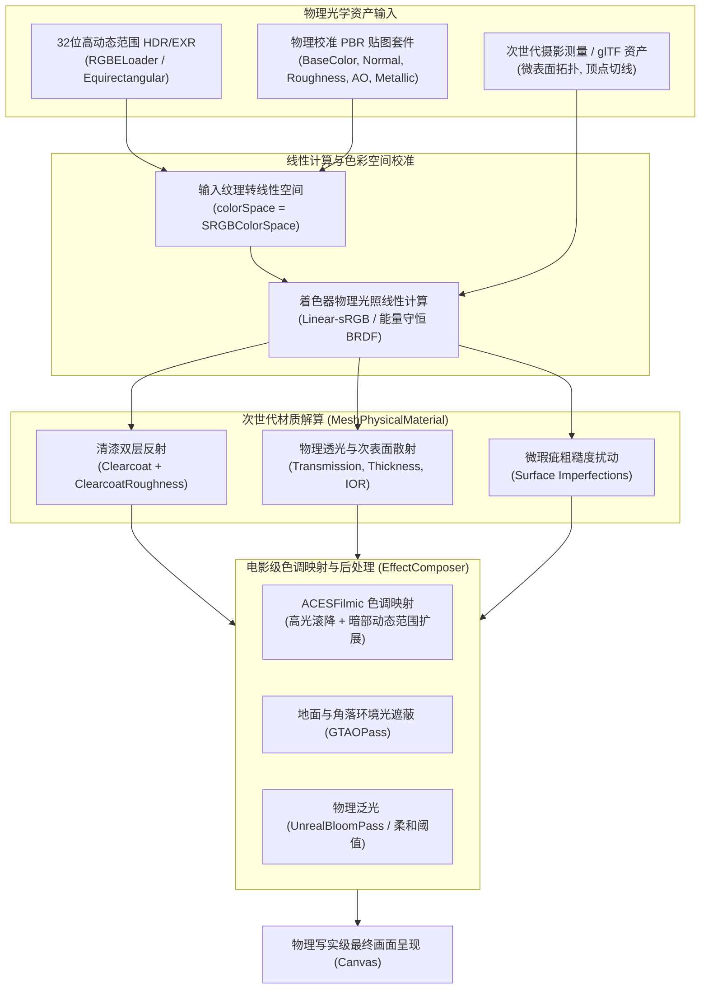

# Three.js 写实级渲染管线（Realistic Pipeline）与高端物理材质配置手册

> 🔗 **关联文档**：本手册针对 WebGL / Three.js 写实渲染领域“画面塑料感严重、高光死白、暗部死黑、材质单薄”等痛点进行系统性攻坚，直接承接 [[wiki/synthesis/threejs-journey-learning-path|Three.js Journey 每日 2 小时自学路径]]（特别是 Day 10 材质系统、Day 22 写实渲染管线配置与 Day 26 后处理通道）。显存与性能底层优化准则请配合 [[wiki/references/threejs-asset-reuse-and-gpu-memory|显存复用模式与性能开销白皮书]] 共同阅读。上一级索引参见 [[wiki/references/index|来源摘要索引]]。

---

## 1. 核心架构：从传统 WebGL 到电影级物理渲染（PBR）管线

制作极其逼近现实质感的 Web 3D 场景，绝不仅是“找一个精致的模型”，而是由**色彩空间物理对齐、环境光学映射（IBL）、次世代双向反射分布函数（BRDF）、微表面瑕疵贴图以及电影级后处理**构成的复合闭环。



---

## 2. 真实光学底座：色彩空间与电影级色调映射（Tone Mapping）

“为什么我的场景颜色发灰发白，像一层塑料薄膜？”——90% 的初学者写实痛点都源于**色彩空间不匹配**与**线性光照截断**。

### 2.1 渲染器色彩空间（Color Space）的绝对基准

计算机屏幕通常以非线性的 **sRGB** 空间显示，而 WebGL 着色器内部的物理光照计算（如朗伯漫反射、微表面微积分）必须在**线性空间（Linear Space）**中进行。

- **历史遗留陷阱**：旧版 Three.js 的 `sRGBEncoding` 已被彻底废弃。
- **现代化生产配置**：
  ```typescript
  // 必须显式声明输出色彩空间为 SRGBColorSpace
  renderer.outputColorSpace = THREE.SRGBColorSpace;
  ```
- **纹理色彩空间对齐法则**：
  - **颜色贴图（`map`）、环境贴图（`envMap`）**：含有感知色彩信息，必须标记为 `THREE.SRGBColorSpace`。
  - **数学物理贴图（`normalMap`、`roughnessMap`、`metalnessMap`、`aoMap`、`displacementMap`）**：内部存储的是纯数学向量或物理标量，**必须保持为 `THREE.NoColorSpace`（默认）**，严禁转为 sRGB，否则会导致粗糙度和凹凸计算全盘错乱！

### 2.2 ACES Filmic 色调映射：告别高光死白

在真实世界中，阳光或金属反光的亮度可以达到成千上万流明，而显示器的输出范围仅有 $[0, 1]$。
- **线性截断（NoToneMapping）**：任何超过 1.0 的高光直接变成惨白的 `rgb(255, 255, 255)`，高光细节彻底丢失。
- **Reinhard 色调映射**：能压缩高光，但容易使画面整体反差变小、发灰发脏。
- **ACES Filmic 色调映射（工业首选）**：学院色彩编码规范（Academy Color Encoding System），广泛用于好莱坞电影工业与虚幻引擎 5。它不仅具备极平滑的高光滚降（Highlight Roll-off），还能自然提升中间调对比度与暗部通透感。

```typescript
// 启用电影级 ACES 色调映射
renderer.toneMapping = THREE.ACESFilmicToneMapping;
// 动态曝光调节（一般在 1.0 ~ 1.5 之间根据 HDR 亮度微调）
renderer.toneMappingExposure = 1.25;
```

---

## 3. 基于图像的真实照明（IBL）：HDR 环境反射

在现实中，物体的反射、金属的质感和环境的漫反射光，有 80% 以上并非来自点光源或平行光，而是来自于**周围真实三维世界的光学包络**。

### 3.1 为什么必须使用 32 位 HDR/EXR？

常规 JPG/PNG 只有 8 位深度（通道取值 0~255），无法记录太阳、摄影棚聚光灯远超环境几百倍的超高动态光强。32 位的 `.hdr` 或 `.exr` 文件能够精确保留极高的辐射率（Radiance），为金属与清漆提供物理级的锐利反光。

### 3.2 现代化 RGBELoader 最佳装配

```typescript
import { RGBELoader } from 'three/addons/loaders/RGBELoader.js';

const rgbeLoader = new RGBELoader();
rgbeLoader.load('/textures/studio_small_08_2k.hdr', (hdrTexture) => {
  // 设置等距柱状投影反射贴图模式
  hdrTexture.mapping = THREE.EquirectangularReflectionMapping;
  
  // 关键：scene.environment 赋能全局所有 PBR 材质的环境反射与环境漫反射
  scene.environment = hdrTexture;
  
  // 如果需要场景背景同步为全景图（可选）
  scene.background = hdrTexture;
  // 可调节背景虚化程度（提升主体聚焦感）
  scene.backgroundBlurriness = 0.5;
  scene.backgroundIntensity = 1.0;
});
```

---

## 4. 次世代物理材质全解：`MeshPhysicalMaterial` 高级参数矩阵

Three.js 的 `MeshStandardMaterial` 仅覆盖基础粗糙度-金属度工作流。若要模拟**高级车漆、碳纤维、抛光木器、真实玻璃、透光玉石、高级丝绒与肥皂泡虹彩**，必须进阶使用继承自它的 `MeshPhysicalMaterial`。

### 4.1 核心参数深度配置对照表

| 高级特性 | 关键配置字段 | 取值范围 | 物理意义与典型实战应用场景 |
| :--- | :--- | :--- | :--- |
| **清漆层 (Clearcoat)** | `clearcoat`<br/>`clearcoatRoughness`<br/>`clearcoatNormalMap` | $0.0 \sim 1.0$<br/>$0.0 \sim 1.0$<br/>Texture | 在底层材质之上覆盖一层无色或微磨损的透明保护漆。**车漆、抛光皮鞋、钢琴烤漆、带水渍的湿润表面**必开。 |
| **物理透光 (Transmission)** | `transmission`<br/>`thickness`<br/>`ior` | $0.0 \sim 1.0$<br/>$0.0 \sim \infty$<br/>$1.0 \sim 2.333$ | 真正的光学体积透光与折射，区别于粗糙的 `opacity` 透明。**高质感磨砂玻璃、香水瓶、水晶灯、树脂道具**核心。 |
| **物理折射率 (IOR)** | `ior` | $1.0 \sim 2.333$ | 折射率：空气 1.0，水 1.333，常规玻璃 1.5，翡翠/塑料 1.5~1.6，钻石 2.42。直接决定菲涅尔反射强弱。 |
| **绒毛光泽 (Sheen)** | `sheen`<br/>`sheenRoughness`<br/>`sheenColor` | $0.0 \sim 1.0$<br/>$0.0 \sim 1.0$<br/>Color | 模拟布料微纤维在掠射角产生的背光微弱高光。**丝绒沙发、呢子大衣、真丝布料**必备。 |
| **薄膜虹彩 (Iridescence)** | `iridescence`<br/>`iridescenceIOR`<br/>`iridescenceThicknessRange` | $0.0 \sim 1.0$<br/>$1.0 \sim 3.0$<br/>$[100, 400]\text{nm}$ | 光波干涉效应引起的彩虹色色散。**肥皂泡、油污积水、昆虫甲壳、镀膜光学镜头、珍珠贝母**。 |

### 4.2 工业级写实车漆与双层反射代码范式

```typescript
const luxuryCarPaint = new THREE.MeshPhysicalMaterial({
  color: new THREE.Color('#8b0000'),      // 底层深红底漆
  metalness: 0.85,                        // 强金属度
  roughness: 0.35,                        // 底层金属颗粒适度粗糙
  
  // 关键：开启清漆层，模拟表面打蜡抛光工艺
  clearcoat: 1.0,                         // 满额清漆层
  clearcoatRoughness: 0.05,               // 表面极度平滑，产生镜面级清晰倒影
  
  // 微表面环境反射增强
  reflectivity: 0.5,
  envMapIntensity: 1.2,
});
```

### 4.3 超写真物理磨砂透光玻璃（Frosted Glass）

```typescript
const frostedGlass = new THREE.MeshPhysicalMaterial({
  color: new THREE.Color('#ffffff'),
  metalness: 0.0,
  roughness: 0.15,                        // 产生高级磨砂毛玻璃微模糊
  
  // 物理透光
  transmission: 0.95,                     // 95% 光学透射
  thickness: 1.5,                         // 模拟物体物理厚度（影响光在介质内的吸收）
  ior: 1.52,                              // 优质冕牌光学玻璃折射率
  
  attenuationColor: new THREE.Color('#e0f7fa'), // 玻璃内部深度吸收后呈现的微弱淡青色
  attenuationDistance: 0.8,               // 吸收衰减距离
  
  transparent: true,                      // 开启透明通道
});
```

---

## 5. 消除“塑料数码感”的核心：微瑕疵贴图矩阵（Surface Imperfections）

在计算机三维图形中，**纯数学生成的完美平面就是“假”的代名词**。真实世界充满指纹、微划痕、冷凝水汽、灰尘和应力磨损。

```
真实 PBR 纹理切片标准装配：
├── 1. BaseColor (RGB - sRGB色彩空间): 物体本身的无光影反射色
├── 2. Normal Map (RGB - NoColorSpace): 表面微观凹凸切线向量
├── 3. Roughness Map (单通道标量 - NoColorSpace): 灰度越浅越粗糙，叠加指纹与磨损
├── 4. Metalness Map (单通道标量 - NoColorSpace): 黑白遮罩，区分纯绝缘体与导体
└── 5. Ambient Occlusion (AO Map - NoColorSpace): 缝隙微阴影，需第二套 UV (uv2)
```

### 5.1 粗糙度贴图的精细调试技巧

很多时候下载的贴图粗糙度整体偏暗或偏亮，直接贴上效果失真。可以通过着色器预处理或使用 `roughness` 标量作为乘法因子：

```typescript
const pbrTextureLoader = new THREE.TextureLoader();

const roughnessMap = pbrTextureLoader.load('/textures/scratched_roughness.jpg');
// 设置环绕与重复度
roughnessMap.wrapS = THREE.RepeatWrapping;
roughnessMap.wrapT = THREE.RepeatWrapping;
roughnessMap.repeat.set(2, 2);

const realisticMetal = new THREE.MeshStandardMaterial({
  color: 0xaaaaaa,
  metalness: 0.9,
  roughness: 1.0,                         // 乘以贴图权重
  roughnessMap: roughnessMap,             // 叠加微划痕微表面
  normalMap: normalMap,
  normalScale: new THREE.Vector2(0.5, 0.5),// 避免法线过度凹凸产生噪点
});
```

---

## 6. 真实光影与阴影系统：柔和投影与物理衰减

### 6.1 开启软阴影过滤（PCFSoftShadowMap）

默认的硬阴影边缘呈现锯齿状死黑切面。真实世界中，光源具有物理体积，边缘产生半影（Penumbra）：

```typescript
// 1. 开启阴影映射并配置柔和阴影过滤
renderer.shadowMap.enabled = true;
renderer.shadowMap.type = THREE.PCFSoftShadowMap;

// 2. 配置定向光源（模拟太阳光）
const sunLight = new THREE.DirectionalLight(0xfff5e6, 2.5);
sunLight.position.set(10, 20, 15);
sunLight.castShadow = true;

// 3. 优化阴影相机视锥体与高精度贴图尺寸
sunLight.shadow.mapSize.width = 2048;
sunLight.shadow.mapSize.height = 2048;
sunLight.shadow.camera.near = 0.5;
sunLight.shadow.camera.far = 50;
sunLight.shadow.camera.left = -10;
sunLight.shadow.camera.right = 10;
sunLight.shadow.camera.top = 10;
sunLight.shadow.camera.bottom = -10;

// 4. 关键：解决阴影痤疮（Shadow Acne）与漏光（Peter Panning）
sunLight.shadow.bias = -0.0005;
sunLight.shadow.normalBias = 0.05; // 利用法线偏移极大改善曲面阴影斑驳
```

---

## 7. 电影级后处理管线（Post-processing）：升华画面质感

在真实摄影中，镜头会产生微弱的光学泛晕、接触阴影和色彩微调。借助 `EffectComposer` 可以大幅提升最终表现力。

```typescript
import { EffectComposer } from 'three/addons/postprocessing/EffectComposer.js';
import { RenderPass } from 'three/addons/postprocessing/RenderPass.js';
import { UnrealBloomPass } from 'three/addons/postprocessing/UnrealBloomPass.js';
import { OutputPass } from 'three/addons/postprocessing/OutputPass.js';

// 1. 创建后处理合成器
const composer = new EffectComposer(renderer);

// 2. 基础渲染通道
const renderPass = new RenderPass(scene, camera);
composer.addPass(renderPass);

// 3. 优雅微泛光通道（切忌滥用大范围辉光，保持极高阈值）
const bloomPass = new UnrealBloomPass(
  new THREE.Vector2(window.innerWidth, window.innerHeight),
  0.25,     // 泛光强度 (strength) - 保持克制，微弱自然即可
  0.4,      // 半径 (radius)
  0.85      // 阈值 (threshold) - 仅让场景中超过 0.85 的极高亮反光边缘发光
);
composer.addPass(bloomPass);

// 4. 最终输出通道（确保色调映射与 sRGB 在后处理管线终点正确应用）
const outputPass = new OutputPass();
composer.addPass(outputPass);

// 渲染循环中切换调用
function tick() {
  requestAnimationFrame(tick);
  composer.render();
}
```

---

## 8. 工业级素材与资产网站推荐矩阵

| 资源类别 | 顶级网站推荐 | 授权类型 | 在写实管线中的核心用途与推荐选择 |
| :--- | :--- | :--- | :--- |
| **超写实扫描模型** | [Fab (Quixel Megascans)](https://fab.com/) | 商业/免费混合 | 电影级摄影测量真实资产，地面岩石、废墟、植被首选。 |
| **低多边形/轻量** | [Poly Pizza](https://poly.pizza/) | CC 许可 | 极速首屏加载的原型或 Low-Poly 风格资产。 |
| **PBR 物理贴图** | [Poly Haven Textures](https://polyhaven.com/textures) | 100% CC0 | 经过精密物理校准的无缝贴图，无人工假阴影，尺寸规范。 |
| **表面微瑕疵** | [Poliigon](https://poliigon.com/) | 免费/付费 | 专业级 Surface Imperfections，指纹、微磨损贴图标杆。 |
| **影棚与室外 HDR** | [Poly Haven HDRIs](https://polyhaven.com/hdris) | 100% CC0 | 室内 Studio 影棚补光与自然全景，真实环境反射核心。 |
| **工业级汽车棚拍** | [HDRMAPS](https://hdrmaps.com/) | 部分免费 | 专为金属高反射、车漆反光板设计的专业 HDR。 |
| **理论圣经** | [Google Filament 白皮书](https://google.github.io/filament/Filament.html) | 开源公开 | 业界最推崇的物理渲染 BRDF 数学原理与材质设计指南。 |

---

## 9. 生产环境避坑指南与显存防爆

1. **纹理尺寸克制（2 的幂次方法则）**：
   - 网页首屏万不可无节制加载 4K/8K 纹理。移动端优先使用 1K（$1024 \times 1024$），桌面端主体模型使用 2K（$2048 \times 2048$）。
   - 纹理分辨率必须为 $2^n$，确保 GPU 正确高效生成 Mipmap。
2. **显存彻底释放（防 SPA 内存泄漏）**：
   - 参考 [[wiki/references/threejs-asset-reuse-and-gpu-memory|显存复用白皮书]]，当切换页面或重置场景时，必须递归遍历网格模型，逐一调用 `geometry.dispose()`、`material.dispose()` 以及每一个贴图切片的 `texture.dispose()`，并显式清理 `renderer.dispose()`。
3. **避免后处理过度堆叠**：
   - 后处理通道（如多重 Blur、SSAO、SSR）每一帧都需要开辟多个全屏离屏渲染目标（WebGLRenderTarget）。在移动端应根据设备性能分级开启，或使用轻量化烘焙替代全动态屏幕空间环境遮蔽。

