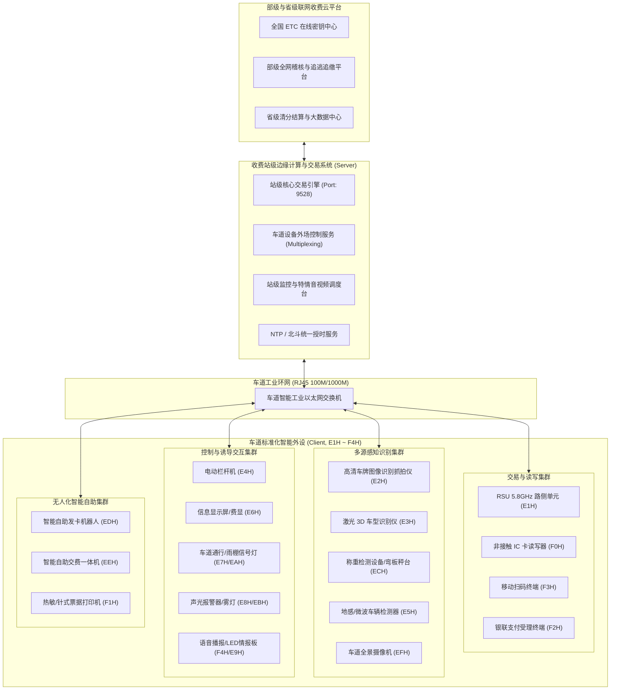

# 收费站标准化试点车道物联网与协同架构全景

> 🔗 **关联文档**：
> - 来源依据：[[wiki/references/highway-toll-lane-device-interface-spec|车道设备接口规范（附件3 V1.97）]]
> - 协议基座：[[wiki/concepts/highway-toll-lane-device-protocol|车道外设标准化通信协议体系]]
> - 交易中枢：[[wiki/concepts/rsu-etc-transaction-flow|RSU 路侧单元与 ETC/CPC 交易流程控制]]
> - 机电终端：[[wiki/concepts/self-service-toll-terminal-state-machine|智能自助发卡与交费终端机电控制与状态机]]
> - 上级索引：[[wiki/synthesis/index|综合分析索引]]

---

## 1. 架构全景：从“碎片孤岛”到“车道微物联网络”

在《高速公路联网收费系统优化升级收费站标准化专项试点技术方案 附件3 车道设备接口规范》（V1.97）发布前，各省收费站外设接口充斥着私有串口（RS-232/485）、定制动态链接库（DLL/SO）及私有网络协议，车道系统对硬件厂商严重绑定，系统扩容与维护成本极高。

本次标准化试点以 **“全 IP 化、全 TCP 化、统一帧协议、统一指令集、动静解耦”** 为战略核心，重塑了车道级物联拓扑架构：



---

## 2. 动静态多源数据交叉融合校验矩阵（全网稽核防逃费）

标准化的核心红利不仅是“接口好写”，更是为**车道多源异构数据在亚秒级内的交叉融合与联合稽核**奠定了统一的数据时间戳与空间基准。

在车辆过车的一瞬间，站级系统汇聚并交叉校验以下四路数据源：

```text
               +-------------------------------------------------------+
               |   车道外场控制服务 1CH 聚合上报 (统一 UnixTime 毫秒戳)   |
               +-------------------------------------------------------+
                                           |
            +------------------------------+-------------------------------+
            |                              |                               |
            v                              v                               v
+-----------------------+      +-----------------------+       +-----------------------+
|  牌照识别 (E2H)       |      |  车型识别 (E3H)       |       |  称重检测 (ECH)       |
| • 车牌号码与颜色      |      | • 激光点云长宽高轮廓  |       | • 称重序列号 AxleId   |
| • 置信度与防伪特征    |      | • 轴数/轴型 (1~9类)   |       | • 轴重明细 AxleWeight |
| • 抓拍图片与 RTSP 串流|      | • 轮距/轴距/车速      |       | • 实际总重与超限标记  |
+-----------------------+      +-----------------------+       +-----------------------+
            |                              |                               |
            +------------------------------+-------------------------------+
                                           |
                                           v
                       +---------------------------------------+
                       |      RSU 路侧单元 (E1H) / OBU 标签     |
                       | • 标签记载车牌 / 颜色                 |
                       | • 标签发行车型 (客1~4, 货1~6, 作1~6)  |
                       | • 卡内余额与二义性路径记录            |
                       +---------------------------------------+
                                           |
                                           v
                        【站级交易核心跨维度一致性校验引擎】
```

### 2.1 典型逃费套路与标准化拦截机制
| 逃费手段 | 物理特征表现 | 标准化多源接口联合拦截逻辑 | 处置联动 |
| :--- | :--- | :--- | :--- |
| **大车小标 / 货车客标** | 货车安装客车 OBU，企图低费率逃费 | RSU 上报车型为一型客车（`01H`），但激光车型识别设备（E3H）识别为六型货车（`10H`），秤台（ECH）轴数显示为 6 轴。 | 站级系统拒绝下发扣费 `C6H` 指令；触发报警器（E8H）长鸣；费显（E6H）提示“车型不符，请走人工车道”；栏杆机（E4H）保持落杆。 |
| **假牌 / 套牌通行** | 悬挂伪造车牌冲关 | 牌识抓拍（E2H）识别车牌与 OBU 内部发行车牌不一致；车身颜色识别（附录 C.2）与发卡系统登记底册冲突。 | 上报部级全网稽查平台（C2）；车道摄像机（EFH）自动启动高帧率追踪录像；抓拍图通过 FTP/HTTP 双轨归档存证。 |
| **跳站 / 假闯卡逃费** | 司机强行冲杆出站 | 车辆检测器（E5H）检测到连续线圈异常有车，但未触发合法交易完成信号。 | 栏杆机（E4H）到位信号与防砸机制触发警示；系统记录 `AxleId` 称重序列号与过车瞬时速度；自动列入全网黑名单追缴追缴库。 |

---

## 3. 标准化对智慧高速全生命周期的重塑价值

1. **外设“即插即用”（Plug & Play）与国产化替代**：
   - 统一端口 9528、统一出厂配置流程（0AH/0BH/1EH/0DH）与统一工作模式验证流程（0EH/1AH/0CH），使得收费站更换任何品牌（华为、万集、金溢、千方、握奇等）的 RSU、牌识或自助终端时，应用层程序**无需修改一行代码**，极大加速了信创与国产化替代进程。
2. **多模块一体化大幅简化车道布线**：
   - 多功能一体机（栏杆+费显+红绿灯+报警器）通过单 IP 多模块组合帧（1BH/B1H、1CH/C1H）传输，将车道岛内线缆数量减少 70% 以上，显著降低雷击与施工损坏风险。
3. **夯实“云收费站”与无人化车道底座**：
   - 详尽的故障状态上报（附录 A.2 与附录 B）配合高安全扫码（CodeLen 扩充）与双工位智能机芯控制，使“远程无人值守、集约化集中座席、异常自动分流”的现代化收费站架构得以在全国范围内大规模标准化推广。
